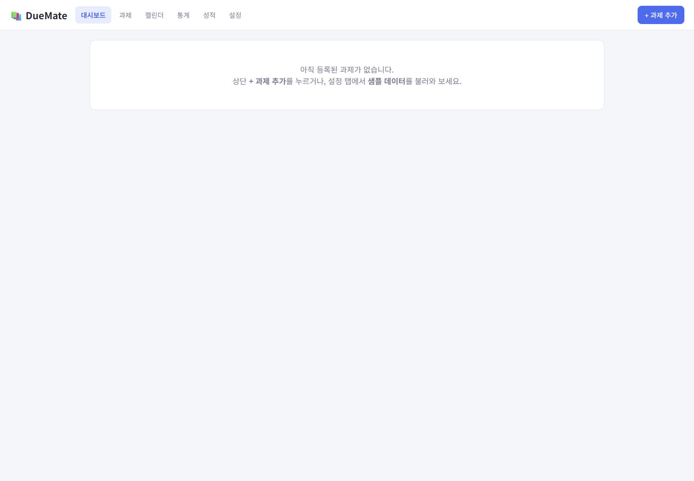

# DueMate

대학생을 위한 과제·일정 관리 웹 앱입니다. 단순히 과제 개수를 나열하는 대신, 마감일까지 남은 시간과 예상 작업 시간을 함께 고려해 지금 처리할 일을 추천합니다.

## 프로젝트 소개

바쁜 시험기간에는 여러 과목의 과제와 시험 공부가 한꺼번에 몰립니다. 해야 할 일은 많은데 무엇부터 시작해야 할지 막막하고, 우선순위를 고민하는 데에도 시간과 에너지가 듭니다. DueMate는 이런 고민을 줄이기 위해 개발한 브라우저 기반 학업 관리 도구입니다. 마감일과 예상 작업 시간, 중요도, 난이도를 함께 살펴보고 지금 처리할 과제를 추천합니다. 데이터는 `localStorage`에 저장되므로 별도 회원가입이나 서버 없이 바로 사용할 수 있습니다.

사이트 바로가기: [DueMate 웹사이트](https://yejineea.github.io/DueMate/)

### 주요 기능

- 과제 CRUD, 마감까지 남은 시간, 완료 상태 및 하위 작업 관리
- 마감 임박도·예상 작업 시간·중요도·난이도 기반 우선순위 추천
- 주간 공부 가능 시간 대비 과제량 과부하 경고
- 오늘 마감·추천 작업·주간 요약을 제공하는 대시보드
- 월간/주간 캘린더, 과제별 작업 타이머, 통계, 성적 관리
- 공부 가능 시간·시간표·테마 설정 및 JSON/CSV 백업·내보내기

## 문서

- [PRD](docs/PRD.md): 문제 정의, 사용자, 기능 요구사항
- [TODO](docs/TODO.md): 구현 단계와 후속 개선 항목

## 실행 화면

## 개발 방법론: 바이브 코딩

요구사항을 작은 기능 단위로 나누고, AI와 대화하며 구현·검증하는 바이브 코딩 방식을 사용했습니다.

장점은 빠른 프로토타이핑, 아이디어를 즉시 화면으로 검증할 수 있는 점, 반복 작업을 줄여 기능 범위에 집중할 수 있다는 점입니다. 반면 요구사항이 모호하면 구현이 흔들릴 수 있고, 생성된 코드의 구조·예외 처리·접근성을 사람이 반드시 검토해야 한다는 한계가 있습니다. 따라서 PRD와 TODO를 기준으로 기능을 쪼개고, 기능 단위 커밋과 브라우저 검증을 함께 진행했습니다.

## 개선할 점

- 공부 가능 시간에 따라 과제를 자동 배정하는 일정 생성 기능
- 브라우저 Notification API를 활용한 마감 알림
- 오프라인 사용을 위한 PWA 지원
- 우선순위 가중치 사용자 설정 및 단위 테스트 추가
- 모바일 접근성·키보드 조작 및 데이터 복원 흐름 고도화

## 결론

DueMate는 과제의 개수가 아니라 실제 필요한 작업 시간을 중심으로 학생의 의사결정을 돕는 도구입니다. 이후 자동 일정 배정과 알림을 추가해, 단순 기록 앱을 넘어 실질적인 학습 계획 도우미로 발전시키는 것이 목표입니다.

## 회고

기능을 작게 나누어 커밋하고 TODO를 갱신하니, 구현 우선순위와 변경 이유를 추적하기 쉬웠습니다. 다음 버전에서는 핵심 계산 로직에 테스트를 추가하고 실제 사용자 피드백을 바탕으로 자동 일정 배정의 기준을 다듬겠습니다.
