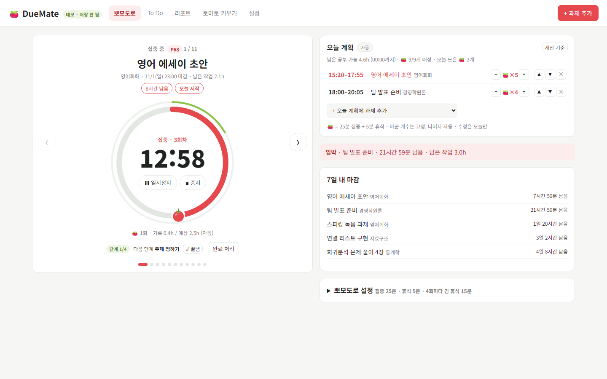
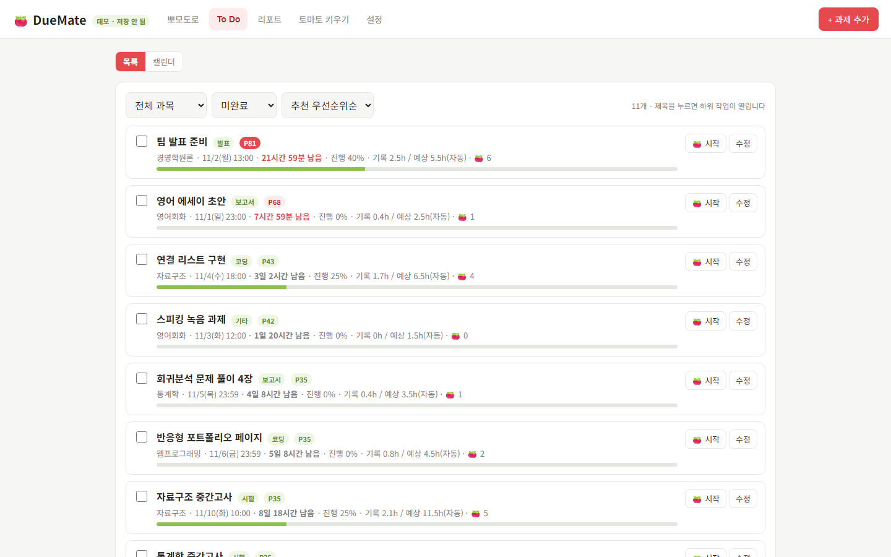
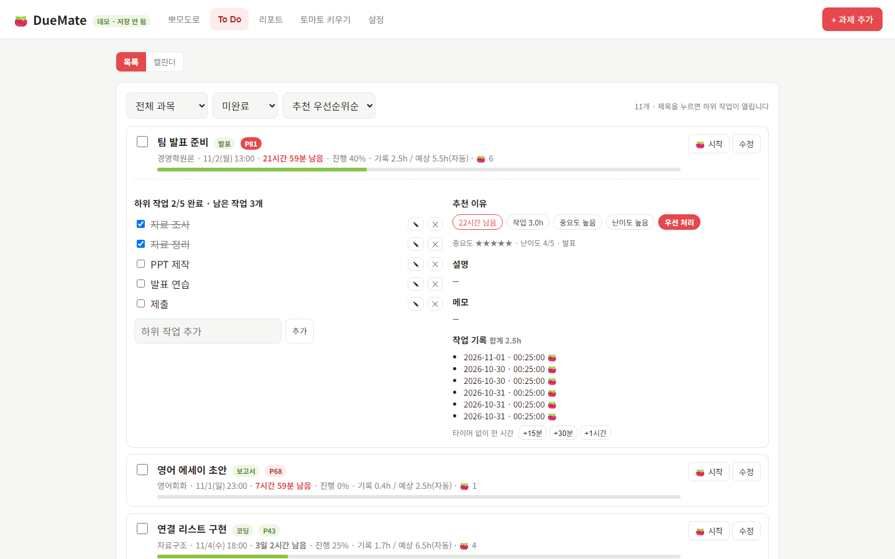
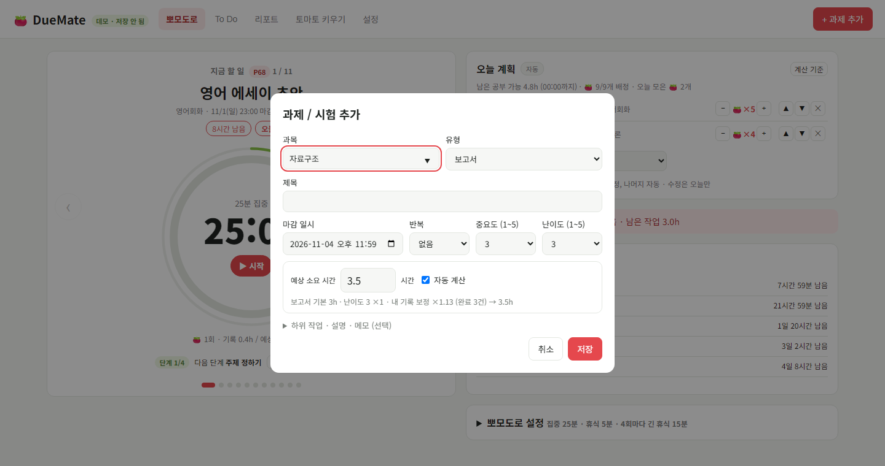
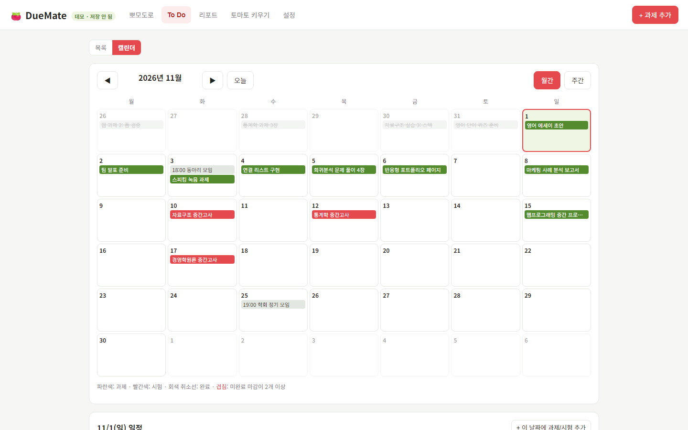
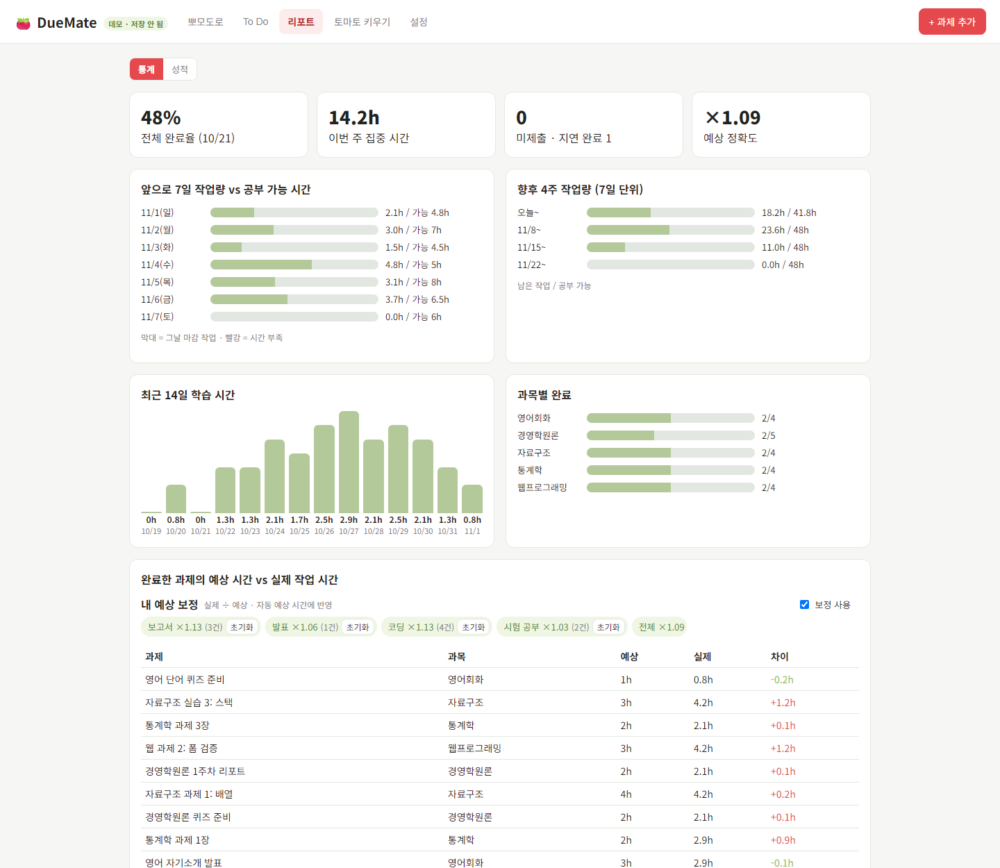
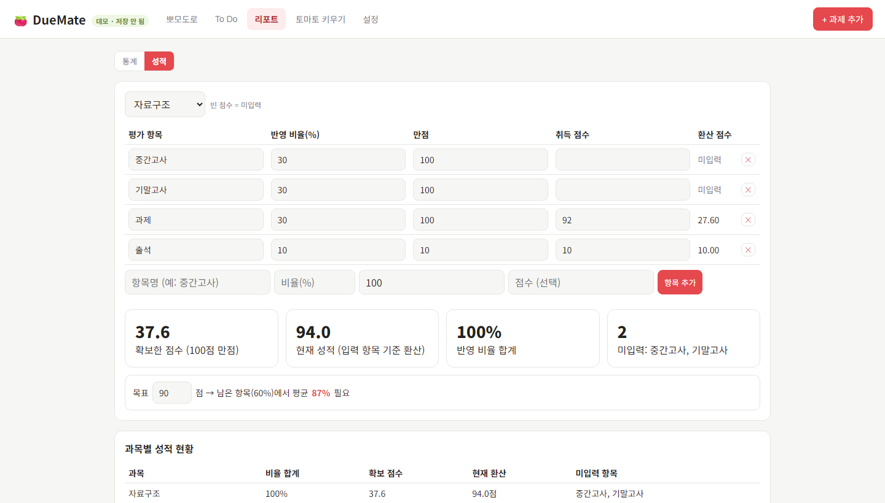
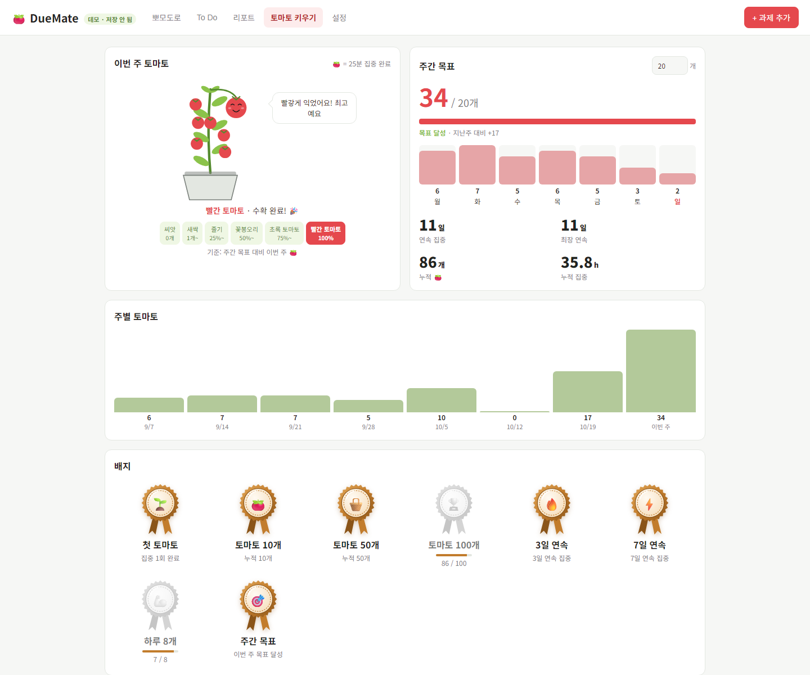
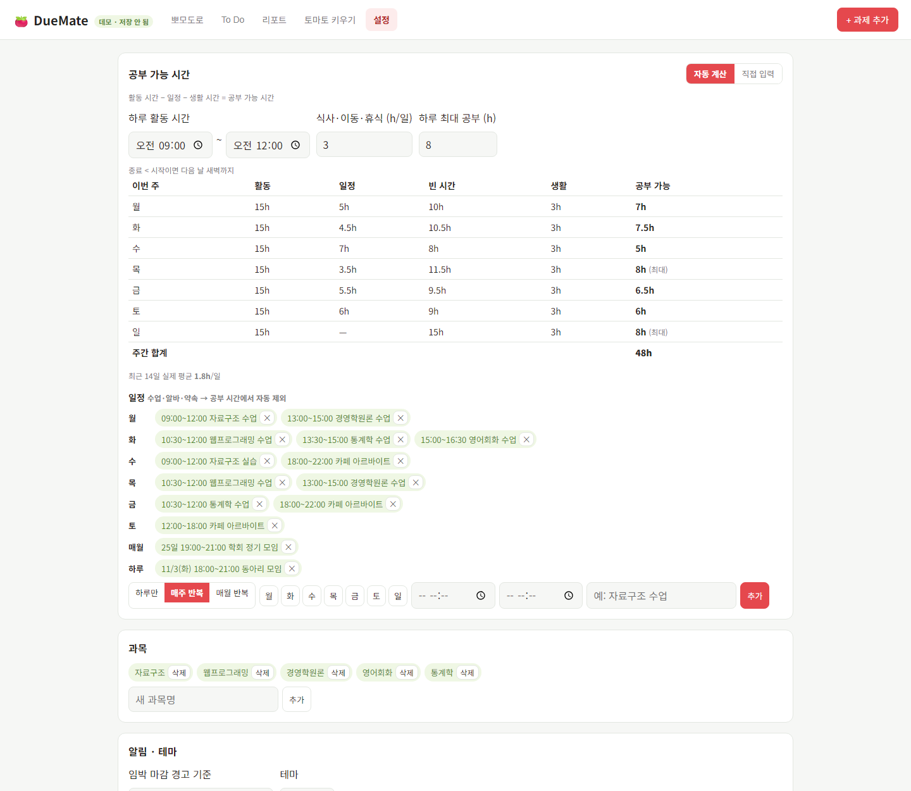
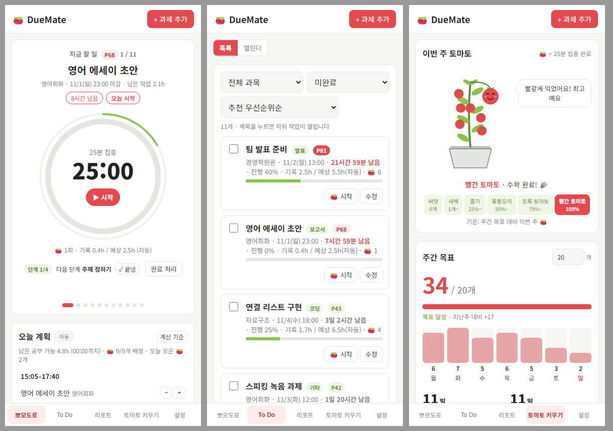

# 🍅 DueMate

할 일이 많은 대학생 대신 **"지금 무엇부터 할지"를 정해 주고, 뽀모도로로 바로 집중하게 해 주는** 과제·일정 관리 웹 앱입니다.

| 바로가기 | 주소 |
| --- | --- |
| 웹사이트 | https://yejineea.github.io/DueMate/ |
| 샘플 데이터로 체험 (저장 안 됨) | https://yejineea.github.io/DueMate/?demo |
| 브라우저 테스트 (139건) | https://yejineea.github.io/DueMate/tests.html |

## 실행 방법

- 브라우저만 있으면 됩니다. 설치·회원가입·서버가 필요 없습니다. 위 주소로 들어가거나 `index.html`을 더블클릭하세요.
- 데이터는 이 브라우저에만 저장됩니다. 다른 기기에서는 **설정 → JSON 백업**한 파일을 **JSON 복원**으로 불러오세요.

**처음 5분 사용법**
1. **설정 → 일정**에 수업·알바를 `매주 반복`으로 넣습니다. 공부 가능 시간이 자동으로 계산됩니다.
2. **+ 과제 추가**에서 과목·유형·제목·마감만 넣습니다. 예상 시간은 자동으로 채워집니다.
3. **뽀모도로 탭** 가운데 큰 원의 **▶ 시작**으로 25분 집중합니다.
4. 집중이 끝나면 "이 단계 끝냈나요?"에 답하고, 과제를 다 하면 **완료 처리**를 누릅니다.
5. **토마토 키우기 탭**에서 이번 주에 모은 🍅만큼 자란 토마토를 확인합니다.

---

## 1. 제작한 것 소개

### 1-1. v1 → v2

시험 기간에는 과제와 시험이 몰려 "무엇부터 할지" 고민하는 데에도 시간이 듭니다. DueMate는 마감까지 남은 시간, 남은 작업량, 수업·알바를 뺀 **실제 공부 가능 시간**을 계산해 지금 할 일을 골라 줍니다. 처음 만든 v1을 직접 써 보니 아쉬운 점이 있었고, v2로 크게 고쳤습니다.

| v1에서 아쉬웠던 점 | v2에서 바꾼 것 |
| --- | --- |
| 첫 화면이 산만해 지금 할 일이 눈에 안 띔 | 첫 화면 = **뽀모도로 탭** (지금 할 일 + 타이머 + 오늘 계획) |
| 공부 가능 시간을 직접 입력 | 일정만 넣으면 **자동 계산** (직접 입력도 가능) |
| 예상 소요 시간을 직접 입력 | 유형·난이도로 **자동 추정**, 실제 작업 시간으로 **보정** |
| 추천을 봐도 바로 시작할 장치가 약함 | 과제별 **뽀모도로 타이머**, 집중 시간 자동 기록 |
| 계속 쓰게 만드는 동기가 없음 | 모은 🍅로 **토마토 키우기**와 배지 |

### 1-2. 탭별 화면과 사용법

#### 🍅 뽀모도로 (첫 화면)

<p align="center"></p>

- **지금 할 일**: 오늘 계획의 첫 과제입니다. 옆으로 밀거나 `‹ ›`·`← →`로 다른 과제로 넘깁니다. 위쪽 태그(`8시간 남음` `중요도 높음` `우선 처리`)가 추천 이유입니다.
- **큰 원 = 타이머**: 빨강은 집중, 연두는 휴식이고 버튼은 원 안에 있습니다. 바깥 얇은 링은 `기록 ÷ 예상` 진행률입니다. 타이머는 **과제마다 따로** 돌아서, 다른 과제를 시작하면 앞 타이머는 남은 시간 그대로 멈춥니다.
- **단계**: `단계 1/4 · 다음 단계 ○○ [✓ 끝냄]`. 🍅를 마치면 "이 단계 끝냈나요?"를 묻습니다.
- **오늘 계획(오른쪽)**: 남은 공부 시간을 🍅(25분 집중 + 5분 휴식) 단위로 `15:20–17:55 영어 에세이 🍅×5`처럼 배치합니다. `− +`(개수), `▲ ▼`(순서), `✕`(오늘 제외)로 **직접 고칠 수 있고**, 고친 내용은 오늘만 유지됩니다.

#### To Do

<table>
<tr>
<td width="50%" valign="top">
<br>
<b>목록</b><br>
미완료 과제가 추천 순서대로 나옵니다. 카드에 마감·진행률·<code>기록 / 예상</code>·🍅 수가 보이고, <b>🍅 시작</b>을 누르면 바로 집중합니다. 완료 직후 6초 안에 <b>되돌리기</b>로 취소할 수 있습니다.
</td>
<td width="50%" valign="top">
<br>
<b>과제 펼침</b> (제목 클릭)<br>
하위 작업(단계)을 추가·체크·수정하고, 추천 이유 태그와 작업 기록을 봅니다. 타이머 없이 한 시간은 <code>+15분</code> <code>+30분</code> <code>+1시간</code>으로 더합니다.
</td>
</tr>
<tr>
<td width="50%" valign="top">
<br>
<b>과제 추가</b><br>
과목·유형·제목·마감만 넣으면 <b>예상 시간이 자동으로 채워지고</b> 계산 근거가 보입니다. <code>반복: 매주/매월</code>이면 완료할 때 다음 회차가 생깁니다.
</td>
<td width="50%" valign="top">
<br>
<b>캘린더</b> (위쪽 <code>목록 | 캘린더</code>)<br>
월간·주간 보기입니다. 시험은 빨강, 하루·매월 일정은 회색, 같은 날 마감이 2개 이상이면 <code>겹침</code>으로 표시됩니다.
</td>
</tr>
</table>

#### 리포트

<table>
<tr>
<td width="50%" valign="top">
<br>
<b>통계</b><br>
앞으로 7일·4주 작업량 vs 공부 가능 시간(모자라면 빨강), 최근 14일 학습 시간, 과목별 완료, 예상 정확도를 봅니다. 아래 <b>내 예상 보정</b>에서 유형별 보정값(<code>코딩 ×1.13</code>)을 보고 <code>초기화</code>하거나 <code>보정 사용</code>을 끌 수 있습니다.
</td>
<td width="50%" valign="top">
<br>
<b>성적</b> (위쪽 <code>통계 | 성적</code>)<br>
평가 항목별 비율·점수로 현재 성적을 계산합니다. <b>목표 점수</b>를 넣으면 <code>남은 항목(60%)에서 평균 87% 필요</code>처럼 알려 줍니다.
</td>
</tr>
</table>

#### 토마토 키우기 · 설정

<table>
<tr>
<td width="50%" valign="top">
<br>
<b>토마토 키우기</b><br>
이번 주 🍅가 주간 목표(기본 20개)에 가까워질수록 토마토가 <code>씨앗 → 새싹 → 줄기 → 꽃봉오리 → 초록 → 빨간 토마토</code>로 자라고, 매달린 토마토의 표정이 울상에서 활짝으로 바뀝니다. 배지 8종이 있고, 아직 못 딴 배지는 <code>86 / 100</code>처럼 진행도가 보입니다.
</td>
<td width="50%" valign="top">
<br>
<b>설정</b><br>
공부 가능 시간 <code>자동 계산 | 직접 입력</code>을 고르고 요일별 계산 근거를 표로 봅니다. 일정은 <code>하루만 | 매주 반복 | 매월 반복</code> 중에 골라 넣습니다. 그 밖에 마감 알림, 다크 모드, 백업(7일 넘게 안 하면 알림)이 있습니다.
</td>
</tr>
</table>

#### 휴대폰

<p align="center"></p>

탭이 아래쪽 바로 바뀌고 화면이 1단으로 정리됩니다.

### 1-3. 핵심 기능의 원리

**① 우선순위**
- 점수 = 마감 임박도(60) + 작업 압박도(30) + 중요도(20) + 난이도(10)
- 작업 압박도 = 남은 작업 ÷ 마감 전 공부 가능 시간
- 남은 작업 = `min(예상 × (1 − 단계 진행률), 예상 − 기록 시간)`

**② 공부 가능 시간: 자동 계산 / 직접 입력**
```
빈 시간       = 하루 활동 시간(기본 09:00~24:00) − 그날 일정(겹치면 병합)
공부 가능 시간 = min(하루 최대 공부(8h), 빈 시간 − 식사·이동·휴식(3h))
```
- 공부 시간이 빈 시간에 고르게 퍼져 있다고 보고, "지금부터 마감까지"는 남은 빈 시간만큼만 셉니다.
- 직접 입력 모드에서는 요일별 시간을 사용자가 정합니다.

**③ 예상 시간 자동 추정과 실제 작업 시간 보정**
```
예상 시간 = 유형별 기본 시간 × 난이도 계수 × 단계 수 계수 × 내 기록 보정
```
- **유형별 기본 시간**: 보고서 3h · 발표 4h · 코딩 5h · 시험 공부 6h · 시험 8h · 기타 2h
- **난이도 계수**: ×0.6 ~ ×1.6
- **단계 수 계수**: 하위 작업이 보통보다 많으면 늘리고 적으면 줄임 (×0.7 ~ ×1.5)
- **내 기록 보정**: 완료한 과제의 `실제 ÷ 예상`을 유형별로 평균 (×0.5 ~ ×2)
  - 기록이 적을 때는 1배 쪽으로 당겨서 계산합니다.
  - 과제를 완료할 때마다 다시 계산되어, 진행 중인 과제의 예상 시간이 바로 갱신됩니다.

**실제 작업 시간은 어떻게 재나요?** 과제의 작업 기록을 모두 더한 값입니다. 휴식 시간은 넣지 않습니다.

| 상황 | 기록되는 시간 | 🍅 |
| --- | --- | --- |
| 25분 집중을 끝까지 마침 | 25분 | +1 |
| 집중 중에 중지 | 실제로 집중한 시간 (1분 이상) | 그대로 |
| 과제 상세의 `+15분/+30분/+1시간` | 그만큼 (지울 수 있음) | 그대로 |
| 완료할 때 "실제로 얼마나 걸렸나요?"에 입력 | 입력값과 기록의 차이만큼 | 그대로 |

기록이 예상의 절반도 안 되는 과제를 완료하면 실제 시간을 묻습니다. 타이머 밖에서 한 작업 때문에 "빨리 끝냈다"로 잘못 보정되지 않게 하기 위해서입니다.

**④ 오늘 계획**
1. 남은 공부 시간 ÷ 30분 = 오늘 쓸 🍅 수
2. 마감까지 고르게 나눴을 때 "오늘 몫"을 먼저 배정합니다. 오늘 마감인 과제가 가장 먼저입니다.
3. 남는 🍅는 우선순위 순으로 더 줍니다.
4. 빈 시간대에 실제 시각으로 배치합니다.

직접 고친 개수는 고정하고, 나머지만 다시 배정합니다.

---

## 2. PRD와 Todo 리스트

- [docs/PRD.md](docs/PRD.md): 바이브코딩 PRD 템플릿 양식 (개요·목적·사용자·페르소나·핵심 기능·만들지 않는 것·디자인·기술 조건·가정·열린 질문·완성 기준)
- [docs/TODO.md](docs/TODO.md): 단계 0(v1 기본 기능) + 단계 1~6(v2), 모든 할 일에 "단계-순번" 번호와 근거 PRD 항목 표시

**PRD 핵심 기능**: 사용자는
1. 앱을 열자마자 우선순위(마감 임박도·남은 작업량·중요도·난이도)로 정해진 "지금 할 일"과 시간대별 오늘 계획을 보고, 직접 고칠 수 있다.
2. 일정만 등록하면 공부 가능 시간을 자동으로 받는다. (직접 입력도 가능)
3. 예상 시간을 직접 넣지 않아도 되고, 쓸수록 자기 속도에 맞춰진다.
4. 과제별 뽀모도로로 바로 집중하고, 시간이 자동으로 기록된다.
5. 모은 🍅로 토마토를 키우며 꾸준함을 확인한다.

**만들지 않는 것**: 로그인, 서버 동기화, 공동 작업

**Todo 단계**

| 단계 | 내용 | 할 일 |
| --- | --- | --- |
| 0 | 기본 기능 (v1에서 완료): 과제 관리, **우선순위 점수**, 과부하 분석, 캘린더, 통계, 성적 | 11 |
| 1 | 화면 정리 | 5 |
| 2 | 공부 가능 시간 자동 계산 | 5 |
| 3 | 뽀모도로 | 5 |
| 4 | 사용 피드백 반영 | 30 |
| 5 | 사용성 점검·개선 | 13 |
| 6 | 품질·문서와 완성 기준 점검 | 6 + 완성 기준 5 |

<details>
<summary>Todo 리스트 전체 보기 (v1 11개 + v2 64개)</summary>

#### 단계 0. 기본 기능 (v1에서 완료)

- 단계 목표: 과제를 관리하고, 과제마다 우선순위 점수를 매겨 지금 할 일을 추천할 수 있다.
- 할 일 목록:

  - [x] 0-1. 프로젝트 구조, 공통 유틸리티, localStorage 저장소 (PRD #7)
  - [x] 0-2. 우선순위 점수 계산 (PRD #4-1)
    - 마감 임박도 (최대 60): 마감 지남 60 · 24시간 안 45 · 3일 안 30 · 7일 안 15 · 그 밖 5
    - 작업 압박도 (최대 30): 남은 작업 ÷ 마감 전 공부 가능 시간 (2배 이상이면 최대)
    - 중요도 (최대 20) = 중요도 × 4, 난이도 (최대 10) = 난이도 × 2
    - 점수가 같으면 마감이 이른 과제가 먼저
  - [x] 0-3. 판정과 추천 이유: 70점 이상 우선 처리 · 45점 이상 오늘 시작 · 그 밖은 여유, 점수를 올린 이유 표시 (PRD #4-1)
  - [x] 0-4. 과부하 분석: 마감 전까지 누적 작업량이 공부 가능 시간보다 많으면 경고 (PRD #4-1)
  - [x] 0-5. 과제 CRUD, 필터·정렬, 하위 작업 진행률 (PRD #4-6)
  - [x] 0-6. 대시보드 추천·경고·주간 요약 (PRD #4-1)
  - [x] 0-7. 공부 가능 시간·시간표·테마·백업 설정 (PRD #4-2, 4-6)
  - [x] 0-8. 월간/주간 캘린더 및 마감 겹침 표시 (PRD #4-6)
  - [x] 0-9. 과제별 작업 타이머와 실제 시간 누적 (PRD #4-4)
  - [x] 0-10. 완료율·과목별·기간별 통계 (PRD #4-6)
  - [x] 0-11. 과목별 평가 항목과 현재 성적 계산 (PRD #4-6)

- 확인 방법: 과제 카드의 P 점수와 추천 이유, 추천 순서가 마감·남은 작업·중요도에 따라 바뀌는지 확인한다.
- v2에서 이어진 것:
  - 점수 공식은 유지했고, 점수 재료가 정확해졌다: 마감 전 가용 시간을 실제 빈 시간으로(2-3), 남은 작업량에 기록 시간 반영(2-5), 예상 시간 자동 추정·보정(4-7), 추천 이유를 짧은 태그로(4-13)
  - 0-6 대시보드 → 뽀모도로 탭(단계 1·4), 0-7 공부 가능 시간 → 자동 계산(단계 2), 0-9 타이머 → 뽀모도로(단계 3)
  - v1 때 남긴 후속 개선 후보: 자동 일정 배정 → 오늘 계획(3-4)으로 진행 · 마감 알림 → 4-21로 진행 · 단위 테스트 → 6-1로 진행 · 우선순위 가중치 사용자 설정 → 대신 오늘 계획 직접 수정(4-15)으로 해결 · PWA → 미진행 (PRD 열린 질문)

#### 단계 1. 화면 정리 — 필요한 기능을 앞에

- 단계 목표: 첫 화면에 "지금 할 일"과 오늘 계획만 남고, 통계·성적은 별도 탭으로 정리된다.
- 할 일 목록:

  - [x] 1-1. 대시보드를 "오늘" 화면으로 재구성: 지금 할 일 1개 → 오늘 계획 → 핵심 경고 순서 (A1) (PRD #4-1, 6)
  - [x] 1-2. 통계 카드·주간/4주 작업량 차트를 대시보드에서 빼서 통계로 이동 (A2) (PRD #4-1, 6)
  - [x] 1-3. 통계·성적 탭을 "분석" 탭 하나로 통합 (탭 6개 → 5개) (A3) (PRD #4-6, 6)
  - [x] 1-4. 과제 카드의 메타 정보를 줄이고 삭제 버튼은 수정 화면으로 이동 (A4) (PRD #4-6, 6)
  - [x] 1-5. (추가) 과제 목록 기본값을 "미완료 · 추천 우선순위순"으로 변경 (A5) (PRD #4-1)

- 확인 방법: 첫 화면을 열었을 때 스크롤 없이 지금 할 일과 오늘 계획이 보이고, 과제 목록이 미완료·추천 순으로 나온다.

#### 단계 2. 공부 가능 시간 자동 계산

- 단계 목표: 일정만 등록하면 요일별 공부 가능 시간과 마감 전 가용 시간이 자동으로 계산된다.
- 할 일 목록:

  - [x] 2-1. 하루 활동 시간대(시작~종료)와 생활 시간(식사·이동·휴식)으로 요일별 공부 가능 시간 자동 산출 (B1) (PRD #4-2)
  - [x] 2-2. 수업·아르바이트 시간표를 시간 구간으로 빼서 계산에 반영 (겹치는 일정 병합) (B2) (PRD #4-2)
  - [x] 2-3. 마감 전 가용 시간을 실제 빈 시간 구간 기준으로 계산 (기존 "09~24시 균등 분포" 가정 제거) (B3) (PRD #4-1, 4-2)
  - [x] 2-4. 설정 화면에 요일별 계산 근거(활동·고정·생활·공부 가능) 표 표시 (B4) (PRD #4-2)
  - [x] 2-5. (추가) 남은 작업량 계산에 기록된 작업 시간 반영 (B5) (PRD #4-1, 4-3)

- 확인 방법: 설정 탭 표에서 요일별 활동·일정·빈 시간·생활·공부 가능 시간이 보이고, 일정을 추가하면 숫자가 바로 바뀐다.

#### 단계 3. 뽀모도로

- 단계 목표: 과제별 뽀모도로로 집중하고, 집중 시간이 기록되며 오늘 계획이 🍅 슬롯으로 배치된다.
- 할 일 목록:

  - [x] 3-1. 과제별 뽀모도로 타이머: 집중 25분 / 짧은 휴식 5분 / 4회마다 긴 휴식 15분 (설정 가능) (C1) (PRD #4-4)
  - [x] 3-2. 집중 완료·중단 시 실제 작업 시간을 과제에 자동 기록 (기존 스톱워치 대체) (C2) (PRD #4-3, 4-4)
  - [x] 3-3. 종료 알림음, 탭 제목 카운트다운, 브라우저 알림 (C3) (PRD #4-4)
  - [x] 3-4. 오늘 계획을 남은 빈 시간대에 뽀모도로 단위 슬롯으로 배치 (C4) (PRD #4-1, 4-4)
  - [x] 3-5. 통계에 일별 뽀모도로 수 표시 (C5) (PRD #4-5)

- 확인 방법: ▶ 시작을 누르면 25분이 줄어들고, 끝나면 과제의 작업 기록에 25분이 쌓이며 오늘 계획에 시각별 🍅가 보인다.

#### 단계 4. 사용 피드백 반영

- 단계 목표: 직접 써 보며 나온 피드백으로 화면·자동 추정·토마토 키우기·일정 입력을 다듬는다.
- 할 일 목록:

  - [x] 4-1. 뽀모도로를 "지금 할 일" 카드 옆 원형 타이머로 옮기고 시작·일시정지·중지 버튼도 그 자리로 (하단 타이머 바 제거) (E1) (PRD #4-4, 6)
  - [x] 4-2. "지금 할 일"·과제 카드의 색 테두리(왼쪽 굵은 색 띠) 제거 (E2) (PRD #6)
  - [x] 4-3. 🍅 배정 기준을 화면에 설명하고 "개 배정" → "집중 N회 배정"으로 표현 변경 (E3) (PRD #4-1)
  - [x] 4-4. 샘플 데이터 최신화: 과제 16개(진행 11·완료 5), 통계학 과목·시험 기간 일정 추가 (E4) (PRD #7)
  - [x] 4-5. 오늘 마감 과제의 몫을 먼저 배정하고, "지금 할 일"을 오늘 계획 첫 슬롯과 일치시킴 (E5) (PRD #4-1)
  - [x] 4-6. 샘플 데이터 날짜 자동 이동: 불러온 날 기준으로 며칠이 지나도 샘플 과제가 지난 과제가 되지 않게 함 (E6) (PRD #7)
  - [x] 4-7. 예상 소요 시간 자동 추정: 유형별 기본 시간 × 난이도 × 하위 작업 수 × 내 기록 보정, 과제를 끝낼 때마다 보정 갱신 (E7) (PRD #4-3)
  - [x] 4-8. 과제 입력 화면 간소화: 설명·메모·하위 작업은 접어 두고, 예상 시간은 자동 계산 + 근거 표시 (E8) (PRD #4-3, 6)
  - [x] 4-9. 탭 재구성: 뽀모도로(지금 할 일·원형 타이머·과제 선택·오늘 계획·뽀모도로 설정) / ToDo(목록·캘린더) / 리포트(통계·성적) / 설정 (E9) (PRD #4-1, 6)
  - [x] 4-10. ~~집중 중 과제 전환: 카드의 과제 선택으로 바로 바꾸고, 남은 시간은 새 과제로 이어 감~~ → E12로 대체 (E10) (PRD #4-4)
  - [x] 4-11. 뽀모도로 탭을 과제 슬라이드로: 옆으로 밀기·‹ ›·점·키보드 ←→로 과제 변경, 큰 원형 타이머를 가운데에, 버튼은 원 안에 (E11) (PRD #4-4, 6)
  - [x] 4-12. 과제별 타이머: 다른 과제를 시작하면 앞 타이머는 남은 시간 그대로 일시정지·보관, 돌아와 재개. 바깥 링에 기록÷예상 진행률 (E12) (PRD #4-4)
  - [x] 4-13. 추천 이유·경고를 문장 대신 짧은 태그/요약으로 (E13) (PRD #4-1, 6)
  - [x] 4-14. 뽀모도로 탭 좌우 배치: 왼쪽 타이머(스크롤 시 고정) / 오른쪽 오늘 계획·경고·7일 내 마감·설정, 슬라이드 안내 문구 삭제 (E14) (PRD #4-1, 6)
  - [x] 4-15. 오늘 계획 직접 수정: 🍅 개수 −/+, 순서 ▲▼, 오늘 제외·되돌리기, 과제 추가, 자동으로 되돌리기 (수정은 그날만 유지) (E15) (PRD #4-1)
  - [x] 4-16. 성과 탭 추가: 🍅 설명, 이번 주 🍅·주간 목표, 요일별·최근 8주 추이, 과목별, 연속 집중일, 배지 (E16) (PRD #4-5)
  - [x] 4-17. 단계(하위 작업) 진행을 뽀모도로 탭에서: 단계 n/전체 표시, ✓ 끝냄 버튼, 집중이 끝나면 "이 단계 끝냈나요?" 질문 (E17) (PRD #4-4)
  - [x] 4-18. 완료 처리 되돌리기: 완료 직후 토스트에 [되돌리기] (6초) (E18) (PRD #4-6)
  - [x] 4-19. 시간표 여러 요일 한 번에 추가 (예: 월·수 수업) (E19) (PRD #4-2)
  - [x] 4-20. 하루 일정(약속·행사): 날짜를 지정한 일정도 공부 가능 시간에서 자동으로 빼고 캘린더에 표시 (E20) (PRD #4-2)
  - [x] 4-21. 마감 브라우저 알림: 임박 기준 시점과 1시간 전에 한 번씩 (E21) (PRD #4-6)
  - [x] 4-22. 하위 작업 수정을 브라우저 입력창(prompt) 대신 그 자리 입력칸으로 (E22) (PRD #4-6)
  - [x] 4-23. 백업 안내: 마지막 백업 날짜 표시, 7일 넘게 백업하지 않으면 설정 맨 위에 알림 (E23) (PRD #7)
  - [x] 4-24. 색 통일: 빨강(토마토 · 실행·긴급) + 연두(진행·완료·휴식) 두 색만 사용, 로고 🍅, 배지를 빨강/연두 원으로 (E24) (PRD #6)
  - [x] 4-25. 성과 탭 → "토마토 키우기"(재미 요소)로: 이번 주 🍅만큼 화분 토마토가 씨앗→새싹→줄기→꽃봉오리→초록→빨간 토마토로 자람, 리포트 뒤로 이동 (E25) (PRD #4-5)
  - [x] 4-26. 일정 추가 통합: 한 폼에서 하루만 / 매주 반복 / 매월 반복 선택 (하루 일정 칸 따로 두지 않음) (E26) (PRD #4-2)
  - [x] 4-27. 긴 설명 문장을 짧게: 토마토 설명, 오늘 계획·설정·리포트·입력 화면 안내 문구 (E27) (PRD #6)
  - [x] 4-28. 토마토 키우기: 단계 기준 표시(씨앗 0개 ~ 빨간 토마토 100%), 단계별 표정 토마토(울상→활짝)와 말풍선 한마디 (E28) (PRD #4-5)
  - [x] 4-29. 리포트·토마토 키우기 그래프 색 채도 낮춤, 탭 이름 To Do, 과제 목록에 🍅 0도 표시, 토마토 파비콘 (E29) (PRD #6)
  - [x] 4-30. 표정을 화분에 매달린 대표 토마토(씨앗 단계는 씨앗)에 직접, 브라우저 탭 제목은 타이머 없이 항상 "DueMate" (E30) (PRD #4-5, 6)

- 확인 방법: 각 항목을 데모 화면(`?demo`)에서 직접 조작해 보고, 피드백으로 요청한 모습과 같은지 확인한다.

#### 단계 5. 사용성 점검·개선

- 단계 목표: 휴대폰·처음 사용자·실제 사용 흐름에서 불편한 점을 찾아 고친다.
- 할 일 목록:

  - [x] 5-1. 휴대폰 화면: 하단 탭바, 타이머가 빈칸으로 보이던 문제 수정, 과제 카드·오늘 계획 줄 정리 (F1) (PRD #3, 6)
  - [x] 5-2. 터치 기기에서 작은 버튼 키우기, 키보드 포커스 표시 (F2) (PRD #3, 6)
  - [x] 5-3. 브라우저 기본 확인창(confirm)을 앱 디자인 확인창으로 (과제·과목 삭제, 복원, 샘플, 초기화) (F3) (PRD #6)
  - [x] 5-4. 슬라이드 순서를 그날 처음 순서로 고정 (타이머 시작해도 섞이지 않음, 계획 직접 수정 시에만 다시 정렬) (F4) (PRD #4-4)
  - [x] 5-5. 처음 사용 안내: ① 일정 등록 → ② 과제 추가 → ③ 첫 🍅, 단계별 체크, 닫기 (F5) (PRD #3)
  - [x] 5-6. 반복 과제(매주·매월): 완료하면 다음 회차 자동 생성(마감 +1주/+1달, 하위 작업 초기화), 되돌리면 함께 삭제 (F6) (PRD #4-6)
  - [x] 5-7. 성적 목표 점수: 과목별 목표를 입력하면 남은 항목에서 필요한 평균(%)·달성 여부 표시 (F7) (PRD #4-6)
  - [x] 5-8. 다크 모드 점검 (2색 팔레트에서 글자·그래프·화분 대비 확인, 수정 사항 없음) (F8) (PRD #6)
  - [x] 5-9. 리포트 탭 정리: 토마토 키우기와 겹치는 🍅 차트·주간/월간 완료 수 제거, 예상 정확도 카드 추가 (F9) (PRD #4-6)
  - [x] 5-10. 예상 보정 조정: 유형별 초기화(이전 기록 제외, ×1.00부터), 보정 사용 끄기 (F10) (PRD #4-3)
  - [x] 5-11. 배지를 동그란 메달 모양으로 (빨간 칠 없이 연두 고리·리본, 못 딴 배지는 회색), 배포 후 새 화면이 바로 보이도록 css/js에 버전 표시(?v=) (F11) (PRD #4-5, 7)
  - [x] 5-12. 타이머 밖 작업 시간 반영: 완료 시 기록이 예상의 절반 미만이면 실제 시간 묻기, 과제 상세에서 +15분/+30분/+1시간 직접 기록·삭제 (F12) (PRD #4-3)
  - [x] 5-13. 최종 README·PRD 정리, 탭별 스크린샷 재촬영 (데모 시계 `&at=` 추가) (F13) (PRD #10)

- 확인 방법: 휴대폰 폭(390px) 스크린샷, 처음 사용자 화면, 확인창·반복 과제·성적 목표·보정 조정을 직접 눌러 확인한다.

#### 단계 6. 품질·문서와 완성 기준 점검

- 단계 목표: 테스트·코드 리뷰·문서를 마치고 PRD의 완성 기준을 하나씩 점검한다.
- 할 일 목록:

  - [x] 6-1. 브라우저에서 여는 테스트 페이지(`tests.html`): 시간 계산·계획·뽀모도로·우선순위·성적 (D1) (PRD #7, 10)
  - [x] 6-2. v1 데이터 호환(마이그레이션) 확인 (D2) (PRD #7)
  - [x] 6-3. README 갱신 (소개, PRD/Todo, 변경 내역, 스킬, 느낀점) 및 스크린샷 교체 (D3) (PRD #10)
  - [x] 6-4. (추가) 데모 모드 `?demo`: 샘플 데이터를 메모리에만 올려 체험·스크린샷·테스트에 사용 (D4) (PRD #7)
  - [x] 6-5. (추가) `code-review` 스킬로 v2 전체 변경 검토 후 지적 사항 수정 (10건 중 9건 수정, 1건 측정 후 제외) (D5) (PRD #7, 10)
  - [ ] 6-6. ~~공부 가능 시간 계산 결과 캐시~~ (제외) (D6) (PRD #7)

- 완성 기준 체크리스트 (PRD #10):

  - [x] 6-7. 앱을 열면 스크롤 없이 지금 할 일·타이머·오늘 계획이 보인다. (PRD #10)
  - [x] 6-8. 일정만 등록하면 공부 가능 시간이 계산되고, 계산 근거를 표로 확인할 수 있다. (PRD #10)
  - [x] 6-9. 과제 입력 시 예상 시간을 직접 넣지 않아도 되고, 완료 기록이 쌓일수록 예상이 내 속도에 맞춰진다. (PRD #10)
  - [x] 6-10. 한 번의 클릭으로 뽀모도로를 시작하고, 집중 시간이 과제에 기록된다. (PRD #10)
  - [x] 6-11. v1 데이터가 유지되고 테스트 페이지의 모든 테스트가 통과한다. (PRD #10)

- 확인 방법: `tests.html`의 모든 테스트가 통과하고, 아래 완성 기준 체크리스트가 모두 체크된다.

#### 추가 제안

작업 중 PRD에 없던 필요가 생긴 항목은 `(추가)`로 표시하고, 이유는 아래 변경 내역에 적었습니다. 채택된 항목은 PRD에도 반영했습니다.

#### 하지 않기로 한 것

- 제외-1. 회원가입/로그인 (PRD #5)
- 제외-2. 서버 동기화(기기 간 자동 동기화) — 다른 기기는 JSON 백업·복원으로 (PRD #5)
- 제외-3. 여러 사람이 함께 쓰는 공동 작업 (PRD #5)

</details>

---

## 3. Todo 리스트의 변경 내역

### 3-1. 한눈에 보기

| 구분 | 처음 계획 | 최종 |
| --- | --- | --- |
| Todo 항목 | 16개 (화면 정리 4 · 공부 시간 4 · 뽀모도로 5 · 품질 3) | **64개** (추가 48) |
| 변경 기록 | — | **60건**: 수정 21 · 테스트 후 변경 21 · 추가 16 · 제외 1 · 스킬 수정 1 |
| 탭 | 대시보드·과제·캘린더·통계·성적·설정 | 뽀모도로·To Do·리포트·토마토 키우기·설정 |
| 테스트 | 계산 로직 테스트 | **139건** (계산·v1 호환·화면·클릭·성능) |

### 3-2. 처음 계획 대비 추가·변경된 기능

**1. 뽀모도로 (계획 → 크게 확장)**
- 위치: 하단 고정 바 → 카드 옆 → **슬라이드 가운데의 큰 원형 타이머, 버튼은 원 안**
- 과제 전환: "남은 시간을 새 과제로 이어 가기"를 만들었다가 **과제별 독립 타이머**로 교체 (과제마다 예상 시간이 다르므로)
- 추가: `기록 ÷ 예상` 진행 링, 단계 체크 질문, 좌우 2단 배치
- 제거: 탭 제목 카운트다운(산만함), 리포트의 🍅 차트(토마토 키우기와 중복)

**2. 공부 가능 시간: 자동 계산 / 직접 입력 (계획 → 구현 + 확장)**
- 직접 입력 모드 유지: 사용자가 정한 값을 업그레이드 후 자동값으로 덮어쓰지 않도록, v1에서 직접 입력하던 사용자는 직접 입력 모드로 옮김
- 일정: 매주 시간표 → **하루만·매주·매월을 한 칸에서**
- 과부하 판단: "이번 주(월~일)" → "앞으로 7일" (일요일에 확인하다 발견)

**3. 예상 시간 자동 추정 + 실제 작업 시간 보정 (계획에 없음 → 추가)**
- 유형 × 난이도 × 단계 수 × 내 기록 보정, 입력 화면 간소화와 계산 근거 표시
- 보정 신뢰성: 기록 1건에 보정이 최대치로 튀던 문제 수정, 완료 과제만으로 비교
- 실제 시간 보완: 완료 시 실제 시간 확인, `+15분/+30분/+1시간` 직접 기록
- 사용자 조정: 유형별 초기화, 보정 끄기 (배율 직접 입력은 자동 계산 취지와 맞지 않아 제외)

**4. 오늘 계획: 자동 배정 + 직접 수정 (계획 → 확장)**
- 오늘 마감인데 점수가 더 높은 내일 과제에 밀리던 문제 → 오늘이 마지막 기회인 과제를 먼저 배정
- 개수·순서·제외·추가를 직접 수정, 오늘만 유지, 자동으로 되돌리기

**5. 성취감을 위한 '토마토 키우기' (계획에 없음 → 추가)**
- "성과" 탭으로 시작 → 리포트와 겹쳐 **재미 요소로 분리**
- 6단계 성장, 단계별 표정·말풍선, 배지(숫자 원 → 아이콘 → **로제트 동메달 + 진행도**)

**6. 화면·탭 구성 (계획 → 여러 차례 재구성)**
- 탭: 6개 → 5개 → 4개 → **5개(토마토 키우기 추가)**
- 색은 **빨강+연두 2색**으로 통일하고, 문장형 안내는 짧은 태그로, 휴대폰 화면도 정리

**7. 사용 흐름 점검으로 추가한 편의 기능**
- 완료 되돌리기, 마감 알림, 반복 과제, 성적 목표 점수, 처음 사용 안내, 앱 디자인 확인창, 백업 안내

**8. 제외·대체**
- ~~계산 결과 캐시~~: 측정해 보니 21ms라 제외하고, 대신 성능 테스트를 추가
- ~~남은 시간 이어 가기~~: 과제별 타이머로 대체

### 3-3. 테스트 후 생긴 변화 (주요 사례)

| 발견 | 문제 → 바꾼 것 |
| --- | --- |
| 스크린샷 | 저장된 데이터가 있으면 **빈 화면** → 초기화 순서 수정 + 저장 데이터로 시작하는 테스트 추가 |
| 코드 리뷰 | 자정 넘는 활동 시간, 숨긴 탭 타이머 지연 등 10건 → 9건 수정, 1건은 측정 후 제외 |
| 휴대폰 폭 확인 | 타이머가 빈칸으로 보임 → 좁은 화면 레이아웃 수정 |
| 클릭 테스트 | 모든 클릭이 "탭 전환"으로 처리 → 속성 이름 변경 |
| 입력 테스트 | 실제 시간 입력칸이 `3` 같은 정수를 거부 → 입력칸 설정 수정 |
| 배포 후 | 새 기능이 안 보임(브라우저 캐시) → css/js 주소에 버전 표시 |

<details>
<summary>상세 변경 기록 전체 보기 (60건)</summary>

| 항목 | 변경 | 이유 |
| --- | --- | --- |
| B5 | **추가**: 남은 작업량 = min(하위 작업 기준, 예상 − 기록 시간). 완료 전에는 예상의 10%를 남김 | 하위 작업이 없는 과제는 뽀모도로를 아무리 해도 남은 작업이 줄지 않아 오늘 계획이 그대로였다. 구현 중 발견 |
| C4 | **테스트 후 변경**: "오늘 시간 부족" 경고를 오늘 마감 과제에만 표시 | 테스트에서 5일 뒤 마감 과제까지 부족 경고가 떴다. 그 몫은 다음 날로 넘어가므로 불필요한 경고였고, 장기 부족은 기존 과부하 경고가 담당 |
| D4 | **추가**: `?demo` 데모 모드 | 헤드리스 브라우저 스크린샷·테스트를 사용자 데이터와 분리하고, README 방문자가 바로 체험할 수 있게 함 |
| A5 | **추가**: 과제 목록 기본 필터를 미완료, 기본 정렬을 추천 우선순위순으로 | 과제 탭을 열었을 때 완료된 과제와 마감일순 목록이 먼저 보여 "무엇부터"라는 핵심과 어긋났다 |
| A1 | **테스트 후 변경**: "지금 할 일" 과제의 임박 마감 경고는 경고 목록에서 제외 | 스크린샷 확인 결과 같은 내용이 카드와 경고에 두 번 나와 화면이 다시 산만해졌다 |
| C4 | **테스트 후 변경**: 뽀모도로가 진행 중이면 그 집중+휴식이 끝난 뒤부터 슬롯 배치 | 집중 중인데 오늘 계획의 첫 슬롯이 현재 시각에 겹쳐 표시됐다 |
| A2 | **테스트 후 변경**: "이번 주(월~일)" 작업량을 "앞으로 7일"로 바꾸고 가용 시간은 지금 이후만 계산 | 일요일에 확인하니 7칸 중 6칸이 지난 날이라 과부하 판단이 사실상 오늘 밤만 보고 있었다 |
| D1 | **수정**: 계산 로직 단위 테스트에 더해 v1 데이터 호환·전 화면 렌더링·실제 클릭/입력 테스트까지 포함 (작성 시 51건 → 리뷰 반영 후 최종 60건) | 계산이 맞아도 버튼 연결이 끊기면 앱이 동작하지 않는다. 헤드리스 Chrome에서 `element.click()`으로 실제 이벤트 흐름을 검증 |
| D5 | **추가**: 코드 리뷰 지적 반영 — v1에서 요일별 시간을 직접 바꿔 둔 사용자는 '직접 입력' 모드로 이전 | 업그레이드하면 사용자가 정한 시간이 자동 계산값으로 조용히 바뀌는 문제. 자동 계산이 목표지만 사용자가 직접 정한 값을 말없이 덮어쓰면 안 된다고 판단 |
| B3 | **테스트 후 변경**(리뷰): 자정을 넘는 활동 시간(예: 10:00~02:00)의 새벽에는 전날 활동일을 "오늘"로 계산 | 새벽 1시에 열면 오늘 계획이 다음 날 하루치를 통째로 잡고 10시부터 시작하는 것으로 표시됐다 |
| C1 | **테스트 후 변경**(리뷰): "탭이 닫혀 있었음" 판정 기준을 1분 → 3분으로, 다음 단계와 기록 날짜는 원래 종료 시각 기준 | 숨긴 탭은 브라우저가 타이머를 최대 1분까지 늦춰 휴식이 자동 시작되지 않았고, 23:50에 끝난 집중이 다음 날로 기록될 수 있었다 |
| C4 | **테스트 후 변경**(리뷰): 배정 수를 실제로 시간표에 들어간 뽀모도로 수로 표시하고, 부족 경고 기준을 "마감 전에 더 공부할 시간이 없는 과제"로 변경 | 빈 시간이 25분보다 잘게 쪼개지면 "6개 배정"이라고 하고 4개만 보였다. 회귀 테스트를 쓰다가 23시 마감·19시 20분 활동 종료 과제가 경고에서 빠지는 버그도 발견 |
| A1 | **테스트 후 변경**(리뷰): 휴식 중에는 "지금 할 일" 버튼을 "휴식 중 · 건너뛰기"로 표시 | 휴식 중인데 "집중 중 · 일시정지"로 보였다 |
| A2 | **테스트 후 변경**(리뷰): 7일 차트의 날짜별 '가능' 시간도 지금 이후만 표시 | 밤 10시에 오늘 칸이 "가능 6h"인데 빨간색(부족)으로 표시되어 모순처럼 보였다 |
| D6 | **제외**: 공부 가능 시간 계산 캐시 | 리뷰에서 성능 문제를 지적했으나, 정렬 시 점수를 과제당 1회만 계산하도록 고친 뒤 과제 46개 기준 가장 느린 화면이 21ms로 측정됐다. 캐시 무효화 버그 위험이 더 크다고 판단해 대신 200ms 성능 테스트를 추가 |
| C1 | **수정**(피드백): 하단 고정 타이머 바 → "지금 할 일" 카드 오른쪽 원형 타이머. 다른 탭에서 시작하면 오늘 화면으로 이동하고, 다른 탭에는 상단에 남은 시간 칩만 표시 | 추천과 실행 버튼을 한 자리에 모아 달라는 피드백. 다른 탭에서는 타이머가 아예 안 보이면 진행 여부를 알 수 없어 칩은 남김 |
| A1·A4 | **수정**(피드백): 카드 왼쪽의 우선순위 색 띠 제거, 긴급도는 남은 시간 글자색과 P 배지로만 표시 | 둥근 모서리에 굵은 색 띠가 그라데이션처럼 보여 산만하다는 피드백 |
| C4 | **수정**(피드백): "🍅 N개 배정" → "집중 N회 배정", 🍅 1개의 의미와 배정 기준을 계획 아래에 설명 | 숫자의 기준과 용도를 알 수 없다는 질문 |
| C4 | **테스트 후 변경**: 1차 배정에서 오늘이 마지막 기회인 과제를 우선순위보다 먼저 처리, "지금 할 일"은 오늘 계획 첫 슬롯으로 | 새 샘플 데이터로 확인하니 오늘 밤 마감 에세이가 점수가 더 높은 내일 마감 발표에 밀려 시간을 하나도 못 받았고, 카드(발표)와 계획(에세이)이 서로 다른 일을 권했다 |
| D4 | **수정**(피드백): 샘플 데이터를 과제 16개로 늘림 | 예전에 불러온 샘플은 날짜가 고정돼 지난 과제만 남아 있었다. 샘플은 불러오는 날 기준 상대 날짜라 다시 불러오면 항상 최신 |
| E6 | **추가**(피드백): 샘플 과제에 표시를 달고, 앱을 열 때 불러온 날과 오늘의 차이만큼 마감·완료·기록 날짜를 함께 이동. 직접 추가한 과제는 이동하지 않음 | 샘플 날짜가 불러온 순간에 고정되어, 나중에 열면 모두 지난 과제로 보였다 |
| E7 | **추가**(피드백): 예상 소요 시간 자동 추정. 유형별 기본 시간(보고서 3h·발표 4h·코딩 5h·시험 공부 6h·시험 8h·기타 2h) × 난이도 계수(0.6~1.6) × 하위 작업 수 계수(0.7~1.5) × 내 기록 보정(완료 과제의 실제÷예상 평균, 0.5~2배) | 예상 시간은 남은 작업량·우선순위·오늘 계획의 기준인데 수기 입력은 번거롭고 일괄 기본값(3h)은 실제와 달랐다. 이미 고르는 유형·난이도만으로 계산하고, 쓸수록 내 속도에 맞춰지게 함 |
| E7 | **테스트 후 변경**: 유형별 보정의 기준점을 '다른 유형 기록'으로 계산 | 테스트에서 기록 1건(예상의 3배)만으로 보정이 최대치 2배까지 올라갔다. 같은 기록이 전체 평균과 유형 평균에 두 번 들어가던 문제 |
| E7 | **테스트 후 변경**: 저장된 데이터가 있으면 앱이 빈 화면이 되던 버그 수정 (상태 초기화를 store.js 맨 끝으로 이동) + 저장 데이터로 시작하는 테스트 추가 | 스크린샷에서 빈 화면 발견. 시작 시 자동 추정이 아직 정의되지 않은 함수를 불렀다. 테스트 브라우저에는 저장 데이터가 없어 단위 테스트로는 잡히지 않았다 |
| E7 | **수정**: 분석 탭의 예상 vs 실제 표를 완료한 과제만으로 | 진행 중 과제까지 들어가 "−9.4h"처럼 아직 안 한 작업이 예상보다 빨리 끝난 것처럼 보였다. 이 표가 보정의 근거이므로 완료 과제만 비교 |
| E9 | **수정**(피드백): 탭 5개(오늘·과제·캘린더·분석·설정) → 4개(뽀모도로·ToDo·리포트·설정). 오늘 화면은 뽀모도로 탭에, 캘린더는 ToDo 탭 안 [목록/캘린더] 전환으로, 뽀모도로 설정은 설정 탭에서 뽀모도로 탭으로 이동 | 사용자가 제안한 4탭 구성에서는 핵심인 "오늘 계획"과 캘린더가 갈 곳이 없어, 결정(오늘 계획)과 실행(타이머)을 한 탭에 두는 안을 제안해 채택. 예전 주소(tab=today 등)도 새 탭으로 연결 |
| E10 | **수정**(피드백): 집중 중 다른 과제를 시작하면 확인창 후 끊고 새로 시작 → 끊지 않고 이어 가기. 지금까지 시간은 이전 과제에 기록, 남은 시간은 새 과제의 집중으로 | 카드에 과제를 바꾸는 수단이 없어 "못 넘어가는 것"처럼 보였고, 바꿀 때마다 타이머가 처음부터 다시 시작되는 것도 흐름을 끊었다 |
| E11 | **수정**(피드백): 과제 선택 드롭다운 → 옆으로 넘기는 슬라이드. 원형 타이머를 가운데로 키우고(156→300px) 버튼을 원 안에 배치 | 드롭다운보다 넘기는 방식이 빠르고, 타이머가 화면의 중심이 되어야 한다는 피드백 |
| E12 | **수정**(피드백): E10의 "남은 시간을 새 과제로 이어 가기"를 과제별 독립 타이머로 교체 | 과제마다 예상 소요 시간이 달라 타이머도 따로 관리해야 한다는 피드백. 바깥 링으로 그 과제의 예상 대비 진행률도 함께 표시 |
| E13 | **수정**(피드백): "마감까지 17시간 남았습니다 · … → 우선 처리하세요" 문장을 `17시간 남음` `시간 부족 3.0h/2.7h` `중요도 높음` `우선 처리` 태그로. 경고도 `임박 · 과제 · 16시간 남음`처럼 요약 | 문장이 길어 한눈에 안 들어온다는 피드백 |
| E11 | **테스트 후 변경**: 스와이프 판정 기준에 최소값(60px) 추가 | 테스트에서 화면 폭이 0으로 잡히는 경우 20px만 움직여도 넘어갔다 |
| E14 | **수정**(피드백): 위아래로 쌓던 뽀모도로 탭을 좌우 2단으로 (좁은 화면은 기존처럼 1단) | 오늘 계획·마감 목록을 보려면 타이머 아래로 한참 스크롤해야 했다 |
| E14 | **테스트 후 변경**: 넓은 화면 판정용 속성을 `data-tab` → `data-current`로 | 처음 구현 때 화면 영역에 `data-tab`을 달자 그 안의 모든 클릭이 "탭 전환"으로 처리되어 클릭 테스트 8건이 한꺼번에 실패했다 |
| E15 | **추가**(피드백): 오늘 계획을 직접 수정. 개수를 정한 과제(0 = 오늘 제외)는 고정하고 남는 시간만 나머지 과제에 자동 재배정, 순서를 바꾸면 그 순서대로 시간대 배치. 수정은 그날(활동일)만 유지 | "결국 본인이 공부하는 것"이라 자동 계산은 출발점일 뿐 최종 결정은 사용자가 해야 한다는 피드백. 자동을 기본으로 두고 필요한 부분만 고치게 함 |
| E15 | **테스트 후 변경**: 직접 늘린 🍅가 빈 시간에 다 들어가지 않으면 "시간 초과 · n개 빠짐" 경고 | 남은 시간보다 많이 늘렸을 때 일부가 조용히 사라지는 것을 테스트로 확인 |
| E16 | **추가**(피드백): 성과 탭(뽀모도로·ToDo·**성과**·리포트·설정 5탭). 주간 목표는 성과 탭에서 직접 설정(기본 20개) | 🍅의 의미 설명과, 주마다 몇 개 모았는지로 성과를 확인하고 싶다는 피드백 |
| D4 | **수정**: 샘플 데이터에 몇 주 전 완료 과제 5개 추가 (총 21개) | 성과 탭의 최근 8주 그래프가 대부분 비어 보였다 |
| E17 | **추가**(피드백): 뽀모도로 탭에서 단계 체크. 🍅을 마치면 슬라이드에 "'구현' 단계를 끝냈나요? [끝냈어요] [아직이에요]"를 띄움 | "다음 단계"가 언제 넘어가는지 알 수 없다는 질문. 단계는 ToDo 탭에서 과제를 펼쳐 체크해야만 넘어갔고, 집중 화면에서 바로 정리할 방법이 없었다. 25분 집중이 곧 단계 완료는 아니므로 자동으로 넘기지 않고 묻는 방식 선택 |
| E18~E23 | **추가**(제안 → 채택): 완료 되돌리기, 시간표 여러 요일, 하루 일정, 마감 알림, 하위 작업 그 자리 수정, 백업 안내 | 사용 흐름을 점검해 제안한 불편 6가지(실수로 완료 시 복구 어려움, 같은 수업 반복 입력, 일회성 일정 미반영, 마감 알림 없음, prompt 입력창, 브라우저에만 저장)를 모두 반영 |
| E20 | **테스트 후 변경**: 테스트가 샘플 시간표와 겹치는 날을 골라 효과가 0으로 나와, 테스트에서 시간표를 비우도록 수정 (기능 자체는 겹치는 일정을 정상 병합) | 일정 병합이 맞게 동작한다는 것을 확인 |
| E24 | **수정**(피드백): 파랑(기본)·주황(경고)·빨강·초록이 섞여 있던 색을 빨강+연두 2색으로. 빨강 = 버튼·선택 탭·집중·🍅·긴급·시험, 연두 = 진행 막대·그래프·예상 대비 진행 링·휴식·완료·일반 과제. 경고(주황)는 연한 빨강, 보통 긴급도는 빨강 테두리로 구분 | 앱 색이 각양각색이라 토마토 컨셉에 맞게 통일해 달라는 피드백. 색에 역할을 하나씩만 주어 의미도 일관되게 함 |
| E25 | **수정**(피드백): 성과 탭을 "토마토 키우기"로 바꾸고 리포트와 따로 유지(뽀모도로·ToDo·리포트·토마토 키우기·설정). 화분 그림이 주간 목표 대비 🍅 비율로 6단계 성장. 배지는 다시 모양 있는 아이콘으로 | 4탭 통합안 대신 재미 요소로 분리하자는 결정. 원 안 숫자 배지는 밋밋하다는 피드백 |
| E26 | **수정**(피드백): E19(여러 요일)·E20(하루 일정)을 일정 하나로 통합. 저장 구조도 schedule 하나에 repeat(once/weekly/monthly)로 합치고, 이전 데이터(시간표·events)는 자동 변환. 매월 반복 추가 | 반복 일정과 하루 일정을 다른 칸에서 넣는 게 번거롭다는 피드백 |
| E27 | **수정**(피드백): "토마토란?" 문단을 한 줄(🍅 = 25분 집중 완료)로, 그 밖의 안내도 `활동 시간 − 일정 − 생활 시간 = 공부 가능 시간`처럼 짧게 | 문장식 설명이 길어 보기 안 좋다는 피드백 |
| E28·E29 | **추가/수정**(피드백): 단계 기준·표정·말풍선, 그래프 채도 낮춤, To Do 이름, 🍅 항상 표시, 파비콘 | To Do 목록에서 🍅가 1개 이상인 과제만 표시되어 "토마토 없는 과제"가 무엇인지 헷갈렸다. 진한 빨강·연두 그래프는 눈이 피로해 채도를 낮춤 |
| E15 | **테스트 후 변경**: 오늘 계획 수정 테스트를 +→− 순서로 | 밤늦게 실행하면 🍅가 1개뿐이라 −를 누르면 바로 제외되어 테스트가 시간대에 따라 실패했다 |
| E30 | **수정**(피드백): 따로 서 있던 토마토 캐릭터를 없애고 가지에 매달린 대표 토마토가 표정을 지음. 탭 제목 카운트다운 제거 | 토마토가 식물에 달린 채로 표정을 짓는 게 자연스럽다는 피드백. 탭 제목의 초가 계속 바뀌어 산만했다 |
| E12 | **테스트 후 변경**: 과제별 타이머 테스트가 슬라이드 순서를 처음 값으로 가정하던 것을 화면에서 다시 읽도록 | 밤늦게는 타이머를 시작하면 오늘 계획이 비어 슬라이드 순서가 바뀌었다 |
| F1 | **테스트 후 변경**: 휴대폰 폭에서 뽀모도로 타이머가 빈칸이던 버그 수정 (좁은 화면 레이아웃 칸을 `1fr` → `minmax(0, 1fr)`) | 처음으로 휴대폰 폭에서 확인하다 발견. `1fr`은 내용의 최소 너비만큼 늘어나 슬라이드 11개 너비가 칸 너비가 되었다 |
| F1 | **스킬 수정**: browser-verify에 `phone` 명령 추가 | 헤드리스 Chrome은 창을 약 500px보다 좁게 못 만들어, 400px 스크린샷이 "가로로 넘친다"고 잘못 보였다. 390px iframe으로 확인하도록 |
| F9 | **테스트 후 변경**: 화면 조작 테스트의 활동 시간을 '지금부터 24시간'으로 고정 | 밤 11시 이후 실행하면 오늘 남은 시간이 없어 오늘 계획 관련 테스트 3건이 실패했다. 기능 문제가 아니라 테스트가 실행 시각에 의존한 문제 |
| F10 | **추가**(피드백): 리포트의 "내 예상 보정"에 유형별 [초기화]와 [보정 사용] 체크 | 보정값을 사용자가 손댈 수 없었다. 자동 계산은 유지하되, 학기 초 기록이 지금과 맞지 않을 때 다시 시작하거나 아예 끌 수 있게 함 (배율 직접 입력은 자동 계산 취지와 맞지 않아 제외) |
| F11 | **수정**(피드백): 배지를 메달 모양으로. **추가**: index.html의 css/js 주소에 `?v=` 버전 | 배포했는데 사용자 화면에 새 기능(보정 초기화)이 안 보였다. GitHub Pages가 파일을 10분 캐시하고 파일 이름이 그대로라 브라우저가 옛 파일을 썼다. duemate-todo-cycle 스킬에 "push 전 버전 올리기" 규칙 추가 |
| F11 | **수정**(피드백): 딴 배지의 고리·리본을 주황~갈색(동메달 느낌)으로. 2색(빨강·연두) 규칙의 유일한 예외로 `--medal` 색 변수를 따로 둠 | 연두 고리는 진짜 배지처럼 보이지 않는다는 피드백 |
| F11 | **수정**(피드백): 배지를 SVG 로제트 메달로 다시 그림 (톱니 테두리 동색 그라데이션, 안쪽 원판·점선 고리·빛 반사, V자 리본). 못 딴 배지에 진행도(예: 86/100) 막대 추가 | 더 예쁘게 해 달라는 피드백. CSS 원·리본만으로는 메달 질감이 나지 않아 SVG로 전환. 진행도는 무엇을 더 하면 되는지 알려 줘 재미 요소를 강화 |
| F12 | **추가**(피드백 질문에서 발견): 실제 작업 시간이 뽀모도로로만 측정되어, 타이머 없이 한 작업은 보정에서 "빨리 끝냈다"로 잘못 계산됨 → 완료 시 확인 질문과 직접 기록 추가 | 기록이 적은 채 완료되는 과제가 쌓이면 유형 보정이 실제보다 낮아져 다음 예상이 짧게 잡힌다 |
| F12 | **테스트 후 변경**: 실제 시간 입력칸의 최소값을 기록 시간 → 0, 간격 0.5 → 0.1 | 최소값(0.4167h)과 간격(0.5)이 겹쳐 "3시간" 같은 값을 브라우저가 거부해 저장되지 않았다. 테스트로 발견 |
| F13 | **추가**: 데모 전용 `&at=15:00` (시계를 그 시각으로 옮김) | 밤 11시 넘어 README 스크린샷을 찍으니 오늘 남은 시간이 없어 오늘 계획이 비어 보였다. 실제 데이터에는 영향 없음 |
| F11 | **추가**(피드백): 타이머의 빨간 시간 호 끝에 파비콘과 같은 토마토가 붙어 원을 따라 움직임 | 남은 시간이 어디까지인지 한눈에 보이고 토마토 컨셉에 맞게 귀엽게 |
| A3 | **수정**: 통계·성적을 한 탭으로 합치되 상단 전환 버튼(통계/성적)으로 구분 | 한 화면에 모두 나열하면 길어져 오히려 산만했다 |

</details>

---

## 4. 스킬

| 스킬 | 종류 | 역할 |
| --- | --- | --- |
| `duemate-todo-cycle` | 직접 제작 | Todo 하나를 구현 → 검증 → 변경 기록 → 커밋·push까지 한 묶음으로 |
| `browser-verify` | 직접 제작 | 헤드리스 Chrome으로 테스트 실행, 탭별·휴대폰 스크린샷 |
| `code-review` | 기존 (Claude Code 기본) | 변경된 코드에서 정확성 버그를 찾아 보고 |

### duemate-todo-cycle (직접 제작)

- **만든 이유**: "계획 대비 변경 기록", "일정 간격 push", "내용이 드러나는 커밋"은 몰입하면 미루기 쉬워서, 매 작업의 정해진 단계로 만들었습니다. Todo 문장은 처음 그대로 두고 변경은 표에 따로 적는 규칙 덕분에 3장의 비교가 가능했습니다.
- **쓰인 방식**: 피드백마다 `구현 → 검증 → TODO 체크·변경 기록 → 커밋 → push`를 반복해 v2 커밋 42개를 기능 단위로 남겼습니다. 작업 중 "push 전 배포 버전 올리기" 규칙을 추가했습니다.

<details><summary>SKILL.md 보기</summary>

````markdown
---
name: duemate-todo-cycle
description: DueMate 저장소에서 docs/TODO.md의 항목을 하나씩 구현할 때 쓰는 작업 사이클. 항목 선택 → 구현 → 브라우저 검증 → TODO 체크와 "변경 내역" 기록 → 내용이 드러나는 커밋 → 일정 간격 push까지를 한 묶음으로 진행한다. "다음 TODO 진행", "이 기능 구현하고 커밋", "TODO 업데이트" 같은 요청이나 DueMate 기능 추가·수정 작업 전반에 사용한다.
---

# DueMate TODO 사이클

과제 조건은 세 가지다. ① Todo 리스트로 작업하면서 **처음 계획 대비 바뀐 점을 기록**한다. ② 다 만들고 한 번에 올리지 않고 **일정 간격으로 push**한다. ③ 커밋 메시지에 **커밋한 내용**이 드러나야 한다. 이 스킬은 세 조건을 매 작업마다 빠짐없이 지키기 위한 절차다.

## 1. 항목 고르기

1. `docs/TODO.md`의 "v2 Todo 리스트"에서 아직 체크되지 않은 항목을 고른다.
2. 서로 의존하는 항목은 엔진 → UI 순서로 묶는다. (예: B1~B3 계산 엔진 → B4 설정 화면)
3. 한 사이클은 **커밋 1~2개 분량**으로 자른다. 화면 개편처럼 큰 항목은 쪼갠다.

## 2. 구현 규칙

- 빌드 도구 없이 브라우저에서 바로 실행되어야 한다. `<script>` 태그로 불러오는 전역 함수 스타일(기존 `js/*.js`)을 그대로 따른다.
- 새 파일을 만들면 `index.html`과 `tests.html`의 스크립트 순서에 모두 추가한다.
- 계산 로직은 `now` 같은 시간 인자를 받는 순수 함수로 작성해 테스트할 수 있게 한다.
- 저장 데이터 구조를 바꾸면 `store.js`의 `normalize()`에 v1 데이터 변환을 함께 넣는다.
- 화면 문구는 한국어, 이모지는 최소한으로 쓴다.

## 3. 검증

`browser-verify` 스킬로 다음을 확인한다.

1. 모든 `js/*.js`에 `node --check` 통과
2. `tests.html` 헤드리스 실행 결과 실패 0건 (계산 로직을 바꿨다면 테스트를 먼저 추가)
3. 바뀐 화면을 `?demo&tab=...` 스크린샷으로 직접 열어 보고 깨진 곳이 없는지 확인

검증에서 문제가 나오면 고친 뒤, **무엇이 문제였고 어떻게 바꿨는지**를 4단계 변경 내역에 남긴다.

## 4. TODO 갱신

- 끝난 항목은 `- [x]`로 체크한다. 항목 문장은 처음 계획 그대로 둔다. (계획과 결과를 비교하기 위해)
- 계획과 다르게 된 경우 "v2 Todo 변경 내역" 표에 한 줄 추가한다.
  - `| 날짜 | 항목 | 변경 | 이유 |`
  - 변경 종류: **수정**(계획한 기능을 다르게 구현), **추가**(계획에 없던 항목), **제외**(하지 않기로 함), **테스트 후 변경**(검증에서 발견한 문제로 바뀐 것)
- 새로 생긴 항목은 리스트 맨 아래 해당 그룹에 `(추가)` 표시와 함께 넣는다. 뺀 항목은 지우지 않고 `~~취소선~~`과 `(제외)`를 붙인다.

## 5. 커밋과 push

- 메시지 형식: `<type>: <무엇을 했는지 한국어로>` — type은 `feat`, `fix`, `refactor`, `test`, `docs`, `chore`, `style` 중 하나.
- 본문에 바뀐 내용을 2~4줄 bullet로 적는다. 관련 TODO 번호(예: `TODO B1~B3`)를 적는다.
- 코드와 그에 해당하는 TODO 체크는 **같은 커밋**에 넣는다.
- 커밋 2개 이내마다 `git push origin main`으로 올린다. 마지막에 몰아서 push하지 않는다.
- push 후 GitHub Pages 배포 워크플로가 돌기 때문에, push 전 3단계 검증을 반드시 통과시킨다.
- 화면·코드를 바꾼 push 전에는 `index.html`의 `?v=` 버전을 올린다. 브라우저가 css/js를 최대 10분 캐시하므로, 버전을 안 바꾸면 사용자는 새로고침해도 옛 화면을 본다.

## 예시

```
feat: 시간표 기반 공부 가능 시간 자동 계산 엔진

- 활동 시간대에서 고정 일정을 빼고 생활 시간을 제외해 요일별 공부 가능 시간 산출
- 마감 전 가용 시간을 실제 빈 시간 구간으로 계산 (09~24시 균등 가정 제거)
- tests.html에 시간 계산 테스트 8건 추가
TODO B1~B3
```
````

</details>

### browser-verify (직접 제작)

- **만든 이유**: 실행 환경이 브라우저라 실제 Chrome 엔진으로 검증해야 했습니다. 매번 사람이 확인하면 건너뛰기 쉬워서, 테스트와 스크린샷을 명령 한 줄로 얻도록 했습니다.
- **쓰인 방식**: 커밋마다 테스트를 돌렸고, 테스트는 0건에서 139건으로 늘었습니다. 빈 화면, 숨은 리본 같은 화면 버그는 스크린샷으로 잡았고, README 스크린샷도 이 스킬로 만들었습니다. 작업 중에 휴대폰 폭 확인(`phone`), 데모 시계(`&at=`)를 추가했습니다.

<details><summary>SKILL.md 보기</summary>

````markdown
---
name: browser-verify
description: 빌드 도구 없는 정적 웹 앱(DueMate)을 헤드리스 Chrome으로 검증한다. JS 문법 검사, 브라우저 테스트 페이지(tests.html) 실행 결과 수집, 데모 데이터로 각 탭 스크린샷 생성을 한 번에 한다. "테스트 돌려줘", "브라우저에서 확인", "스크린샷 갱신", "README 이미지 다시 찍기", 커밋 전 검증이 필요할 때 사용한다.
---

# 브라우저 검증

DueMate의 실행 환경은 브라우저로 한정된다. Node에서 돌리는 테스트는 `localStorage`, `document`, 오디오 같은 실제 실행 환경과 다르므로, 테스트와 화면 확인을 **실제 Chrome 엔진**으로 한다. 사람이 브라우저를 열어 클릭하지 않아도 되도록 헤드리스 모드를 쓴다.

## 준비물

- Chrome: 기본 경로 `C:/Program Files/Google/Chrome/Application/chrome.exe` (다르면 `CHROME` 환경변수로 지정)
- Node: `node --check` 문법 검사용
- 앱 쪽 훅
  - `tests.html`: 로드되면 테스트를 실행하고 `<body data-result="pass|fail">`와 `#summary`에 결과를 쓴다.
  - `index.html?demo`: 샘플 데이터를 메모리에만 올리는 데모 모드 (사용자 데이터를 건드리지 않음)
  - `index.html?demo&tab=<탭>`: 특정 탭으로 바로 연다. `&pomo`를 붙이면 뽀모도로가 진행 중인 상태로 연다.
  - `&at=15:00`: 데모의 시계를 그 시각으로 옮긴다. 밤에 찍어도 오늘 계획이 비지 않게 README 스크린샷은 이 값으로 찍는다. `&theme=dark`는 다크 모드, `&form`은 과제 추가 화면, `&open`은 첫 과제를 펼친 화면.

## 사용법

Bash에서 저장소 루트 기준으로 실행한다.

```bash
# 1) 문법 검사 + 테스트
bash .claude/skills/browser-verify/verify.sh test

# 2) 스크린샷 한 장: 이름, 쿼리, (선택) 높이
bash .claude/skills/browser-verify/verify.sh shot pomodoro "demo&tab=pomodoro"

# 3) README용 전체 탭 스크린샷 (docs/images/v2-*.png)
bash .claude/skills/browser-verify/verify.sh shots

# 4) 휴대폰 폭(390px) 확인: 탭 3개를 나란히 한 장으로
bash .claude/skills/browser-verify/verify.sh phone "pomodoro todo settings"
```

- 헤드리스 Chrome은 창 너비를 약 500px보다 줄이지 못한다. `--window-size=400`으로 찍으면 500px로 그린 뒤 잘라 보여 주므로 "가로로 넘친다"고 오판하기 쉽다. 휴대폰 화면은 반드시 `phone`(390px iframe)으로 확인한다.

- `test`는 실패한 테스트 이름과 메시지를 출력하고, 실패가 있으면 종료 코드 1을 돌려준다.
- 스크린샷은 1440px 너비로 찍는다. 찍은 뒤 이미지 파일을 직접 열어 보고 레이아웃이 깨지지 않았는지 확인한다.

## 판단 기준

- 테스트 실패가 하나라도 있으면 커밋하지 않는다.
- 테스트는 통과했는데 스크린샷이 이상하면(겹침, 빈 화면, 잘림) 화면 버그로 보고 고친다.
- 헤드리스 결과가 비어 있으면 스크립트 오류 가능성이 높다. `--enable-logging=stderr --v=0` 출력의 `CONSOLE` 줄을 확인한다.
- 검증에서 찾은 문제와 해결은 `duemate-todo-cycle` 스킬 규칙에 따라 TODO 변경 내역에 남긴다.
````

</details>

### code-review (기존 스킬)

- **고른 이유**: 직접 만든 테스트는 내가 떠올린 경우만 검사합니다. 이 스킬은 변경된 코드에서 **"어떤 입력에서 어떻게 틀리는지"** 실패 시나리오 중심으로 버그를 찾아 줘서, 내가 놓친 경우를 보완하는 데 맞았습니다.
- **쓰인 방식**: 1차 기능을 완성한 뒤 v2 변경 전체를 검토했고, 10건이 나왔습니다. 9건은 수정하고 회귀 테스트를 붙였고, 1건(캐시)은 측정 후 제외했습니다.
- Claude Code 내장 스킬이라 저장소에 SKILL.md는 없습니다. 아래는 스킬 설명입니다.

> Review the current diff, or a PR number/branch/path target, for correctness bugs (plus reuse/simplification/efficiency cleanups where the model's recipe covers them) at the effort level given first, before any target (low|medium|high|xhigh|max). Pass --comment to post findings as inline PR comments, or --fix to apply them to the working tree after the review.

---

## 5. 느낀점과 결론

### 느낀점

- **계획은 16개였지만 끝나고 보니 64개였다.** 써 보고 화면을 보면서 계획이 계속 바뀌었습니다. 바뀔 때마다 이유를 남겨 두니, 지금 "왜 이렇게 됐는지"를 모두 설명할 수 있습니다.
- **자동화의 목표는 '대신 결정하기'가 아니라 '결정을 쉽게 하기'였다.** 만들면서, 공부하는 사람은 결국 사용자 본인이고 자동 계산이 그날의 사정까지 알 수는 없다는 생각에 이르렀습니다. 사용자가 정한 값을 앱이 말없이 덮어써서도 안 된다고 판단했습니다. 그래서 **자동 계산은 출발점이고 최종 결정은 사용자에게 둔다**는 원칙으로 바꾸고, 모든 자동 기능에 직접 수정·되돌리기·끄기를 두었습니다.
- **측정할 수 있는 것과 없는 것을 구분해야 한다.** 앱은 타이머로 잰 시간만 압니다. 계산이 정교해도 입력되는 데이터가 틀리면 결과가 틀리기 때문에, 실제 시간을 확인하고 직접 기록하는 기능으로 보완했습니다.
- **검증 방법이 결과물의 질을 정한다.** 빈 화면, 휴대폰에서 사라진 타이머, 밤에만 실패하는 테스트는 단위 테스트로는 보이지 않았습니다. 실제 브라우저, 실제 화면, 다른 시간대에서 확인할 때만 드러났습니다.

### 방법론: 요구사항 기반 바이브 코딩 + Todo 사이클

`PRD·Todo → AI가 작은 단위로 구현 → 브라우저 테스트·스크린샷 검증 → 직접 써 보고 피드백 → 변경 내역 기록`을 반복했습니다.

- **장점**
  - **속도**: 피드백에서 반영까지 몇 분이면 되어 하루 안에 수십 번 고칠 수 있었습니다.
  - **추적성**: 스킬로 절차를 고정하니 커밋, Todo, 변경 내역이 항상 함께 갱신되었습니다.
  - **안정성**: 매 커밋 테스트를 돌려서 이미 되던 기능이 깨지지 않았습니다.
  - **외부 시선**: 코드 리뷰로 내가 놓친 경우를 찾았습니다.
- **단점**
  - **모호한 요청은 여러 번 왕복합니다.** "더 예쁘게" 같은 요청이 그렇고, 배지만 다섯 번 바뀌었습니다.
  - **부분 수정이 쌓이면 기능이 겹칩니다.** 같은 🍅 차트가 리포트와 성과 탭 두 곳에 생겨 나중에 정리해야 했습니다.
  - **자동화로 확인할 수 없는 부분이 있습니다.** 실기기 알림음, 터치감, 브라우저 캐시는 사람이 직접 써 봐야 압니다.
  - **테스트 자체가 틀릴 수도 있습니다.** 실행 시각에 따라 실패하는 테스트를 고치는 데에도 시간이 들었습니다.
- **개선이 필요한 점**
  - 디자인 요청은 구현 전에 시안 2~3개를 먼저 보여 줍니다. 탭 구성은 이 방식으로 한 번에 정해졌습니다.
  - 피드백 몇 개마다 겹치는 기능을 전체적으로 점검하는 단계를 둡니다.
  - 자동화가 못 보는 항목(실기기·배포 후 화면)은 체크리스트로 따로 확인합니다.
  - 유형별 기본 시간과 보정 방식은 실제 사용자 데이터로 다듬습니다.

### 결론

DueMate v2는 **입력은 줄이고(자동 계산), 실행은 한 번에(첫 화면 타이머), 쓸수록 정확하게(실제 시간 보정), 꾸준함에는 보상을(토마토 키우기)** 주는 방향으로 "무엇부터 할지"의 결정을 쉽게 만들었습니다. 자동으로 계산하되 언제든 직접 고칠 수 있게 한 것이 v1과 가장 큰 차이입니다. 다음에는 PWA로 탭을 닫아도 알림을 받고, 실제 사용자 기록으로 예상 시간 계산을 다듬고 싶습니다.
