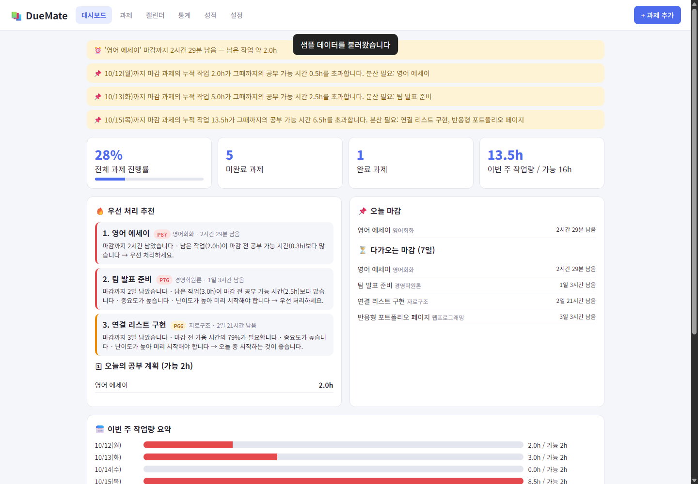
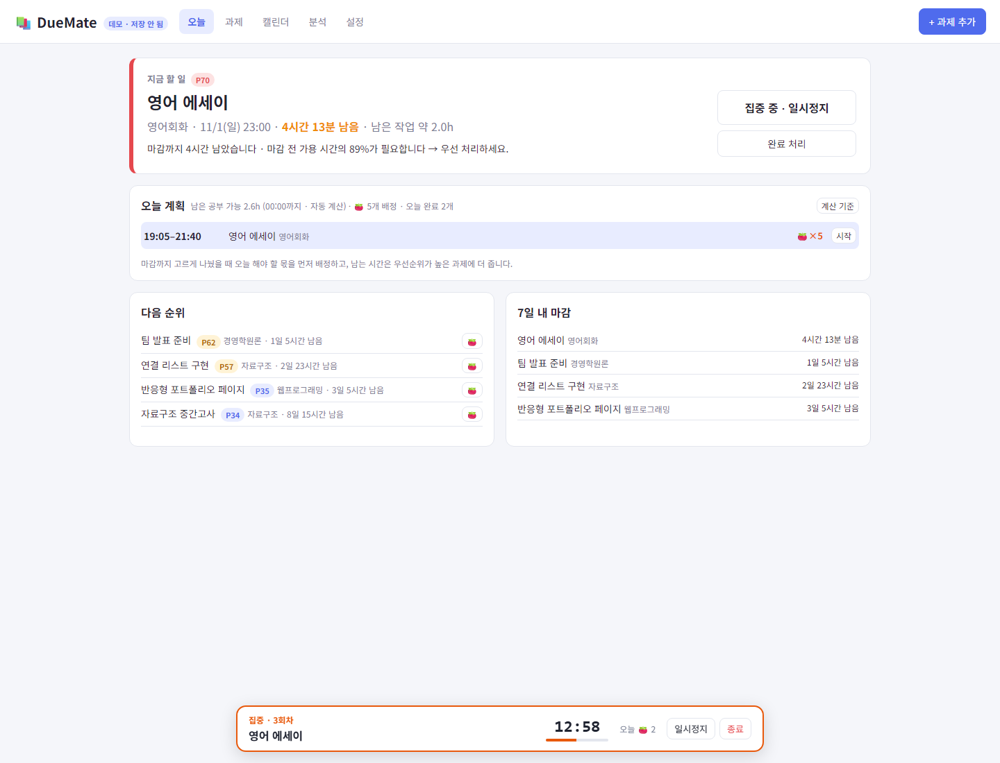
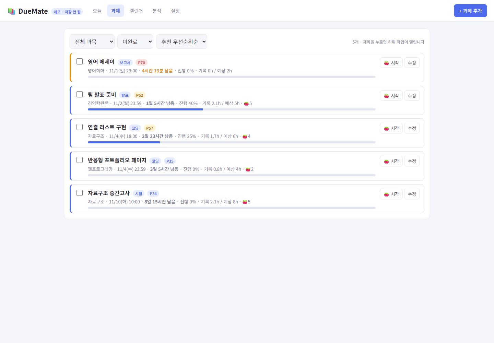
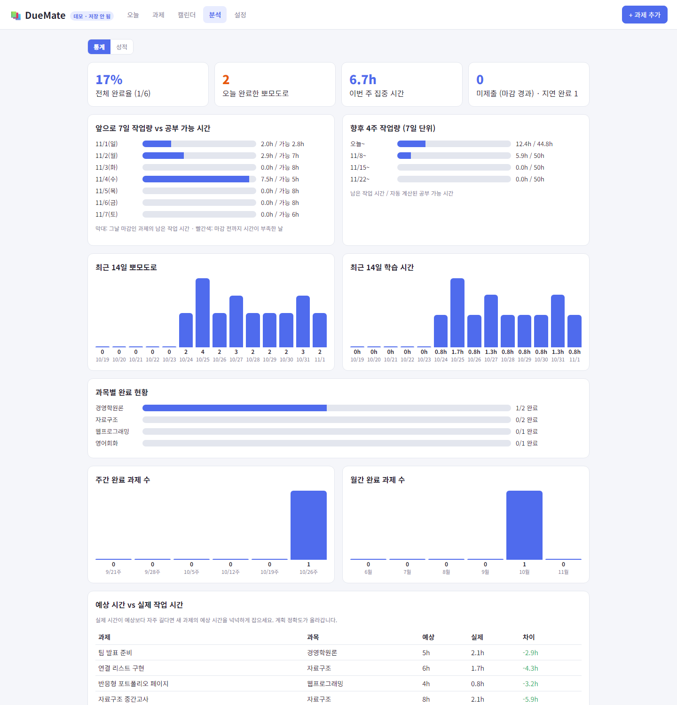

# DueMate

할 일이 많은 대학생 대신 **"지금 무엇부터 할지"를 결정해 주는** 과제·일정 관리 웹 앱입니다.

| 바로가기 | 주소 |
| --- | --- |
| 웹사이트 | https://yejineea.github.io/DueMate/ |
| 샘플 데이터로 체험 (저장 안 됨) | https://yejineea.github.io/DueMate/?demo |
| 브라우저 테스트 (60건) | https://yejineea.github.io/DueMate/tests.html |

## 실행 방법

실행 환경은 **브라우저**입니다. 빌드나 서버 설치가 필요 없습니다.

- 위 웹사이트 주소로 접속하거나, 저장소를 내려받아 `index.html`을 브라우저로 엽니다.
- 처음이라면 `?demo` 주소로 샘플 데이터가 들어간 화면을 먼저 보거나, 설정 탭의 **샘플 데이터 불러오기**를 누르세요.
- 데이터는 브라우저 `localStorage`에 저장되므로 회원가입 없이 바로 쓸 수 있습니다. 설정 탭에서 JSON으로 백업·복원합니다.
- `tests.html`을 열면 핵심 계산과 화면 조작 테스트가 브라우저에서 실행되고 결과가 표시됩니다.

---

## 1. 제작한 것 소개

시험기간에는 여러 과목의 과제와 시험이 한꺼번에 몰립니다. 해야 할 일이 많을수록 "무엇부터 할지" 고민하는 데에도 시간과 에너지가 듭니다. DueMate는 마감일, 남은 작업량, 중요도, 난이도, 그리고 **실제로 쓸 수 있는 공부 시간**을 함께 계산해서 지금 할 일 하나를 골라 주고, 버튼 하나로 바로 집중을 시작하게 합니다.

10월에 만든 v1을 직접 써 보니 세 가지 문제가 있었습니다. 이번 v2는 이 문제들을 해결하는 데 집중했습니다.

| v1에서 불편했던 점 | v2에서 바꾼 것 |
| --- | --- |
| 첫 화면에 통계 카드, 주간 차트, 4주 차트, 추천, 마감 목록이 한꺼번에 있어 정작 **지금 할 일이 눈에 띄지 않음** | 첫 화면을 **"오늘"** 화면으로 바꿈: 지금 할 일 1개 → 시간대별 오늘 계획 → 핵심 경고만. 통계는 분석 탭으로 이동 |
| 요일별 공부 가능 시간을 **직접 어림잡아 입력**해야 했고, 시간표에 수업을 넣어도 계산에 반영되지 않음 | 하루 활동 시간에서 **시간표와 생활 시간을 빼서 자동 계산**. 마감 전 가용 시간도 실제 빈 시간 구간으로 계산 |
| 추천을 봐도 바로 시작할 장치가 약하고, 스톱워치는 집중 리듬을 잡아 주지 못함 | 추천 과제에서 바로 시작하는 **뽀모도로**. 집중이 끝나면 작업 시간이 자동 기록되어 남은 작업량과 추천 순위가 갱신됨 |

### 첫 화면 비교

| v1 대시보드 | v2 "오늘" 화면 |
| --- | --- |
|  |  |

### 핵심 기능

**① 지금 할 일 1개와 이유.** 우선순위 점수(마감 임박도 최대 60 + 작업 압박도 최대 30 + 중요도 20 + 난이도 10)가 가장 높은 과제를 맨 위에 보여 줍니다. 왜 이 과제인지("마감까지 4시간 · 마감 전 가용 시간의 89%가 필요")와 다음 하위 작업도 함께 보여 줍니다.

**② 공부 가능 시간 자동 계산.** 직접 입력하는 대신 아래처럼 계산합니다.

```
빈 시간       = 하루 활동 시간(예: 09:00~24:00) − 수업·알바 시간표(겹치면 병합)
공부 가능 시간 = min(하루 최대 공부 시간, 빈 시간 − 식사·이동·휴식 시간)
예) 샘플 데이터의 월요일: 활동 15h − 수업 5h = 빈 시간 10h → 10h − 생활 3h = 공부 가능 7h
```

공부 가능 시간은 그날의 빈 시간 구간에 고르게 퍼져 있다고 보고, "지금부터 마감까지"의 가용 시간을 구간 단위로 계산합니다. 예를 들어 저녁 6시 반이면 오늘은 남은 빈 시간만큼만 셉니다. 설정 탭에서 요일별 계산 근거(활동·수업/알바·빈 시간·생활·공부 가능)를 표로 확인할 수 있고, 원하면 직접 입력 모드로 바꿀 수 있습니다.

**③ 오늘 계획을 뽀모도로 슬롯으로 배치.** 오늘 남은 공부 시간을 30분(집중 25 + 휴식 5) 단위로 나눈 뒤 두 단계로 배정합니다.
1. 마감까지 고르게 나눠 했을 때 **오늘 해야 하는 몫**을 우선순위 순서로 먼저 배정
2. 남는 뽀모도로는 우선순위가 높은 과제에 남은 작업량만큼 추가

배정된 뽀모도로는 수업 사이 빈 시간에 `19:05–21:40 영어 에세이 🍅×5`처럼 실제 시각으로 배치되고, 4회마다 긴 휴식이 들어갑니다. 오늘 마감인데 시간이 모자라면 몇 개가 부족한지 경고합니다.

**④ 뽀모도로.** 집중 25분 → 짧은 휴식 5분 → … → 4회마다 긴 휴식 15분(길이는 설정 가능). 종료 알림음, 탭 제목 카운트다운(`12:58 집중 · DueMate`), 브라우저 알림을 지원합니다. 집중을 마치면 25분이 과제의 작업 기록에 자동으로 저장되고, 중간에 그만두면 집중한 시간만 기록합니다.

**⑤ 그 밖의 기능 (v1에서 유지).** 과제 CRUD와 하위 작업, 월간/주간 캘린더와 마감 겹침 표시, 7일·4주 과부하 분석, 통계, 평가 항목 기반 성적 계산, 다크 테마, JSON/CSV 내보내기.

### 화면

| 과제 | 캘린더 |
| --- | --- |
|  |  |
| 기본 목록은 **미완료 · 추천 우선순위순**입니다. 카드에는 마감·진행률·기록 시간만 남기고 중요도·난이도는 펼친 상세로 옮겼습니다. | 같은 날 미완료 마감이 2개 이상이면 "겹침"으로 강조합니다. |

| 분석 (통계) | 분석 (성적) |
| --- | --- |
|  |  |
| 앞으로 7일·4주 작업량과 자동 계산된 공부 가능 시간 비교, 최근 14일 뽀모도로, 예상 vs 실제 시간을 봅니다. | 통계와 성적을 한 탭으로 합치고 상단 버튼으로 전환합니다. |

| 설정 |
| --- |
|  |
| 공부 가능 시간 자동 계산 근거 표, 요일별로 묶은 시간표, 뽀모도로 길이·알림 설정입니다. |

### 구조

```
index.html        앱 진입점 (탭 5개: 오늘 · 과제 · 캘린더 · 분석 · 설정)
tests.html        브라우저 테스트 페이지
js/
  utils.js        날짜·시간 포맷, 차트 헬퍼
  store.js        상태·localStorage 저장, v1 데이터 변환, 샘플 데이터, ?demo 모드
  availability.js [v2] 활동 시간 − 시간표 − 생활 시간 → 공부 가능 시간, 구간 단위 가용 시간
  priority.js     우선순위 점수와 추천 이유, 7일 과부하 분석
  planner.js      [v2] 오늘 계획: 뽀모도로 배정과 빈 시간 슬롯 배치
  pomodoro.js     [v2] 뽀모도로 상태 전이, 기록, 알림, 타이머 바 (v1 timer.js 대체)
  dashboard.js    "오늘" 화면
  tasks.js · calendar.js · stats.js · grades.js · settings.js · app.js
  tests.js        [v2] 테스트 60건
```

---

## 2. PRD와 Todo 리스트

전체 문서: [docs/PRD.md](docs/PRD.md) · [docs/TODO.md](docs/TODO.md)

### PRD 요약

- **목표 사용자**: 여러 과목의 과제·시험을 병행하며 제한된 시간 안에서 계획을 세워야 하는 대학생
- **핵심 가치**: ① 결정 대행(지금 할 일 1개와 오늘 계획) ② 현실적인 시간 계산(시간표를 뺀 실제 빈 시간) ③ 바로 실행(뽀모도로와 자동 기록) ④ 과부하 감지
- **비기능 요구사항**: 서버 없이 브라우저에서 실행, 빌드 도구 없음, v1 데이터 그대로 불러오기, 핵심 계산은 브라우저 테스트로 검증
- **성공 기준**: 앱을 열면 스크롤 없이 지금 할 일과 시작 버튼이 보인다 / 시간표만 등록하면 공부 가능 시간이 계산되고 근거를 볼 수 있다 / 한 번의 클릭으로 뽀모도로를 시작하고 집중 시간이 기록된다 / v1 데이터가 유지되고 테스트가 모두 통과한다

| 우선순위 | 기능 | 버전 |
| --- | --- | --- |
| P1 | 과제 관리, 우선순위 엔진 | v1 |
| P1 | 오늘 화면 (지금 할 일, 시간대별 계획, 핵심 경고) | **v2 개편** |
| P1 | 공부 가능 시간 자동 계산 | **v2 신규** |
| P1 | 뽀모도로 | **v2 신규** |
| P2 | 캘린더, 분석(통계+성적), 설정·백업 | v1 / v2 통합 |

### v2 Todo 리스트 (최종 상태)

처음 계획한 문장은 그대로 두고 체크만 했습니다. `(추가)`는 작업 중에 새로 생긴 항목, 취소선은 하지 않기로 한 항목입니다.

**A. 화면 정리 — 필요한 기능을 앞에**
- [x] A1. 대시보드를 "오늘" 화면으로 재구성: 지금 할 일 1개 → 오늘 계획 → 핵심 경고 순서
- [x] A2. 통계 카드·주간/4주 작업량 차트를 대시보드에서 빼서 통계로 이동
- [x] A3. 통계·성적 탭을 "분석" 탭 하나로 통합 (탭 6개 → 5개)
- [x] A4. 과제 카드의 메타 정보를 줄이고 삭제 버튼은 수정 화면으로 이동
- [x] A5. (추가) 과제 목록 기본값을 "미완료 · 추천 우선순위순"으로 변경

**B. 공부 가능 시간 자동 계산**
- [x] B1. 하루 활동 시간대(시작~종료)와 생활 시간(식사·이동·휴식)으로 요일별 공부 가능 시간 자동 산출
- [x] B2. 수업·아르바이트 시간표를 시간 구간으로 빼서 계산에 반영 (겹치는 일정 병합)
- [x] B3. 마감 전 가용 시간을 실제 빈 시간 구간 기준으로 계산 (기존 "09~24시 균등 분포" 가정 제거)
- [x] B4. 설정 화면에 요일별 계산 근거(활동·고정·생활·공부 가능) 표 표시
- [x] B5. (추가) 남은 작업량 계산에 기록된 작업 시간 반영

**C. 뽀모도로**
- [x] C1. 과제별 뽀모도로 타이머: 집중 25분 / 짧은 휴식 5분 / 4회마다 긴 휴식 15분 (설정 가능)
- [x] C2. 집중 완료·중단 시 실제 작업 시간을 과제에 자동 기록 (기존 스톱워치 대체)
- [x] C3. 종료 알림음, 탭 제목 카운트다운, 브라우저 알림
- [x] C4. 오늘 계획을 남은 빈 시간대에 뽀모도로 단위 슬롯으로 배치
- [x] C5. 통계에 일별 뽀모도로 수 표시

**D. 품질·문서**
- [x] D1. 브라우저에서 여는 테스트 페이지(`tests.html`): 시간 계산·계획·뽀모도로·우선순위·성적
- [x] D2. v1 데이터 호환(마이그레이션) 확인
- [x] D3. README 갱신 (소개, PRD/Todo, 변경 내역, 스킬, 느낀점) 및 스크린샷 교체
- [x] D4. (추가) 데모 모드 `?demo`: 샘플 데이터를 메모리에만 올려 체험·스크린샷·테스트에 사용
- [x] D5. (추가) `code-review` 스킬로 v2 전체 변경 검토 후 지적 사항 수정 (10건 중 9건 수정, 1건 측정 후 제외)
- [ ] ~~D6. 공부 가능 시간 계산 결과 캐시~~ (제외)

---

## 3. Todo 리스트의 변경 내역

처음 계획은 16개 항목이었습니다. 진행하면서 **추가 5개(A5, B5, D4, D5, D6 — 이 중 D6은 측정 후 제외), 기능 수정 2건(A3, D1), 테스트 후 변경 9건**이 생겼습니다. 바뀐 내용은 작업하면서 [docs/TODO.md](docs/TODO.md)에 바로 기록했습니다.

### 한눈에 보기: 처음 계획 vs 결과

| 항목 | 처음 계획 | 실제 결과 |
| --- | --- | --- |
| A2 작업량 차트 | 대시보드의 "이번 주"·4주 차트를 통계로 옮김 | 옮기면서 **"이번 주(월~일)" → "앞으로 7일"**로 바꾸고, 가용 시간은 지금 이후만 계산 |
| A3 탭 통합 | 통계·성적을 한 탭으로 | 한 화면에 다 나열하면 길어져서 **탭 안의 통계/성적 전환 버튼**으로 구분 |
| B3 마감 전 가용 시간 | 실제 빈 시간 구간 기준 | + **자정을 넘는 활동 시간**(예: 10:00~02:00)의 새벽 처리 추가 |
| B5 (계획에 없음) | — | 뽀모도로로 기록한 시간이 **남은 작업량에 반영**되도록 계산식 변경 |
| C1 뽀모도로 | 집중/휴식 타이머 | + 숨긴 탭에서 타이머가 늦게 처리될 때와 탭을 닫아 둔 경우를 구분 |
| C4 오늘 계획 | 빈 시간대에 슬롯 배치 | 부족 경고 기준을 두 번 고침, **진행 중인 뽀모도로 뒤부터** 배치, 실제로 들어간 개수만 표시 |
| D1 테스트 | 계산 로직 단위 테스트 | v1 호환·전 화면 렌더링·**실제 클릭/입력** 테스트까지 60건 |
| 기본값 (리뷰) | v1 사용자도 자동 계산 | 요일별 시간을 직접 바꿔 둔 v1 사용자는 **직접 입력 모드로 이전** |
| D6 (계획에 없음) | — | 리뷰에서 계산 캐시를 제안받았지만 **측정 후 제외** |

### 상세 기록

| 날짜 | 항목 | 변경 | 이유 |
| --- | --- | --- | --- |
| 11-01 | B5 | **추가**: 남은 작업량 = min(하위 작업 기준, 예상 − 기록 시간). 완료 전에는 예상의 10%를 남김 | 하위 작업이 없는 과제는 뽀모도로를 아무리 해도 남은 작업이 줄지 않아 오늘 계획이 그대로였다. 구현 중 발견 |
| 11-01 | C4 | **테스트 후 변경**: "오늘 시간 부족" 경고를 오늘 마감 과제에만 표시 | 테스트에서 5일 뒤 마감 과제까지 부족 경고가 떴다. 그 몫은 다음 날로 넘어가므로 불필요한 경고였고, 장기 부족은 기존 과부하 경고가 담당 |
| 11-01 | D4 | **추가**: `?demo` 데모 모드 | 헤드리스 브라우저 스크린샷·테스트를 사용자 데이터와 분리하고, README 방문자가 바로 체험할 수 있게 함 |
| 11-01 | A5 | **추가**: 과제 목록 기본 필터를 미완료, 기본 정렬을 추천 우선순위순으로 | 과제 탭을 열었을 때 완료된 과제와 마감일순 목록이 먼저 보여 "무엇부터"라는 핵심과 어긋났다 |
| 11-01 | A1 | **테스트 후 변경**: "지금 할 일" 과제의 임박 마감 경고는 경고 목록에서 제외 | 스크린샷 확인 결과 같은 내용이 카드와 경고에 두 번 나와 화면이 다시 산만해졌다 |
| 11-01 | C4 | **테스트 후 변경**: 뽀모도로가 진행 중이면 그 집중+휴식이 끝난 뒤부터 슬롯 배치 | 집중 중인데 오늘 계획의 첫 슬롯이 현재 시각에 겹쳐 표시됐다 |
| 11-01 | A2 | **테스트 후 변경**: "이번 주(월~일)" 작업량을 "앞으로 7일"로 바꾸고 가용 시간은 지금 이후만 계산 | 일요일에 확인하니 7칸 중 6칸이 지난 날이라 과부하 판단이 사실상 오늘 밤만 보고 있었다 |
| 11-01 | D1 | **수정**: 계산 로직 단위 테스트에 더해 v1 데이터 호환·전 화면 렌더링·실제 클릭/입력 테스트까지 포함 (작성 시 51건 → 리뷰 반영 후 최종 60건) | 계산이 맞아도 버튼 연결이 끊기면 앱이 동작하지 않는다. 헤드리스 Chrome에서 `element.click()`으로 실제 이벤트 흐름을 검증 |
| 11-01 | D5 | **추가**: 코드 리뷰 지적 반영 — v1에서 요일별 시간을 직접 바꿔 둔 사용자는 '직접 입력' 모드로 이전 | 업그레이드하면 사용자가 정한 시간이 자동 계산값으로 조용히 바뀌는 문제. 자동 계산이 목표지만 사용자가 직접 정한 값을 말없이 덮어쓰면 안 된다고 판단 |
| 11-01 | B3 | **테스트 후 변경**(리뷰): 자정을 넘는 활동 시간(예: 10:00~02:00)의 새벽에는 전날 활동일을 "오늘"로 계산 | 새벽 1시에 열면 오늘 계획이 다음 날 하루치를 통째로 잡고 10시부터 시작하는 것으로 표시됐다 |
| 11-01 | C1 | **테스트 후 변경**(리뷰): "탭이 닫혀 있었음" 판정 기준을 1분 → 3분으로, 다음 단계와 기록 날짜는 원래 종료 시각 기준 | 숨긴 탭은 브라우저가 타이머를 최대 1분까지 늦춰 휴식이 자동 시작되지 않았고, 23:50에 끝난 집중이 다음 날로 기록될 수 있었다 |
| 11-01 | C4 | **테스트 후 변경**(리뷰): 배정 수를 실제로 시간표에 들어간 뽀모도로 수로 표시하고, 부족 경고 기준을 "마감 전에 더 공부할 시간이 없는 과제"로 변경 | 빈 시간이 25분보다 잘게 쪼개지면 "6개 배정"이라고 하고 4개만 보였다. 회귀 테스트를 쓰다가 23시 마감·19시 20분 활동 종료 과제가 경고에서 빠지는 버그도 발견 |
| 11-01 | A1 | **테스트 후 변경**(리뷰): 휴식 중에는 "지금 할 일" 버튼을 "휴식 중 · 건너뛰기"로 표시 | 휴식 중인데 "집중 중 · 일시정지"로 보였다 |
| 11-01 | A2 | **테스트 후 변경**(리뷰): 7일 차트의 날짜별 '가능' 시간도 지금 이후만 표시 | 밤 10시에 오늘 칸이 "가능 6h"인데 빨간색(부족)으로 표시되어 모순처럼 보였다 |
| 11-01 | D6 | **제외**: 공부 가능 시간 계산 캐시 | 리뷰에서 성능 문제를 지적했으나, 정렬 시 점수를 과제당 1회만 계산하도록 고친 뒤 과제 46개 기준 가장 느린 화면이 21ms로 측정됐다. 캐시 무효화 버그 위험이 더 크다고 판단해 대신 200ms 성능 테스트를 추가 |
| 11-01 | A3 | **수정**: 통계·성적을 한 탭으로 합치되 상단 전환 버튼(통계/성적)으로 구분 | 한 화면에 모두 나열하면 길어져 오히려 산만했다 |

### 커밋 기록 (Todo 단위로 나눠 push)

| 커밋 | 내용 | 관련 Todo |
| --- | --- | --- |
| `a8da6dc` | docs: v2 PRD와 Todo 리스트, 작업용 프로젝트 스킬 추가 | 계획 |
| `40136f3` | feat: 시간표 기반 공부 가능 시간 자동 계산 엔진과 오늘 계획 배정 | B1~B3, B5, D4 |
| `1896faa` | feat: 설정에 공부 가능 시간 자동 계산 화면과 계산 근거 표 추가 | B4 |
| `1e2ea30` | feat: 과제별 뽀모도로 타이머로 스톱워치 대체 | C1~C3 |
| `f0a4361` | feat: 첫 화면을 "오늘" 화면으로 개편하고 통계·성적을 분석 탭으로 통합 | A1~A5, C4, C5 |
| `860a31c` | test: v1 데이터 호환·화면 렌더링·실제 클릭 테스트 추가 | D1, D2 |
| `95deb6d` | fix: 코드 리뷰 지적 사항 수정 (자정 넘는 활동 시간, v1 직접 입력값 보존 등) | D5 |
| (이 커밋) | docs: README와 스크린샷 v2로 갱신 | D3 |

---

## 4. 스킬

이번 작업에는 스킬 3개를 썼습니다. 2개는 이 프로젝트에 맞춰 직접 만들었고(`.claude/skills/`), 1개는 Claude Code에 기본으로 들어 있는 스킬입니다.

| 스킬 | 종류 | 한 줄 요약 |
| --- | --- | --- |
| `duemate-todo-cycle` | 직접 제작 | Todo 항목 하나를 구현 → 검증 → 변경 기록 → 커밋·push까지 한 묶음으로 진행 |
| `browser-verify` | 직접 제작 | 헤드리스 Chrome으로 테스트 실행과 스크린샷 생성 |
| `code-review` | 기존 스킬 (Claude Code 기본) | 변경된 코드에서 정확성 버그를 찾아 보고 |

### 4-1. duemate-todo-cycle (직접 제작)

**만든 이유.** 과제 조건 중 지키기 까다로운 것이 세 가지였습니다. ① 처음 계획 대비 바뀐 점을 기록할 것 ② 다 만들고 한 번에 올리지 말고 일정 간격으로 push할 것 ③ 커밋 메시지에 내용을 담을 것. 셋 다 작업에 몰입하다 보면 "나중에 한꺼번에" 하게 되기 쉽습니다. 그래서 이 조건들을 매 작업의 정해진 단계로 만들어 빠뜨리지 않게 했습니다. 특히 "항목 문장은 처음 계획 그대로 두고 변경 내역 표에 따로 적는다"는 규칙 덕분에, 위 3장처럼 계획과 결과를 나란히 비교할 수 있었습니다.

**작업에서 쓰인 방식.**
- v2 커밋은 모두 이 형식(`type: 한국어 요약` + bullet 본문)을 따르고, 기능 커밋에는 관련 TODO 번호를 적었습니다.
- 엔진(B1~B3) → 화면(B4) → 뽀모도로(C1~C3) → 화면 개편(A, C4~C5) → 테스트(D1~D2) → 리뷰 수정(D5) 순서로, 커밋 1~2개마다 push했습니다.
- 검증에서 문제가 나오면 고친 뒤 "테스트 후 변경"으로 기록하는 규칙 덕분에, 9건의 테스트 후 변경이 모두 이유와 함께 남았습니다.

````markdown
---
name: duemate-todo-cycle
description: DueMate 저장소에서 docs/TODO.md의 항목을 하나씩 구현할 때 쓰는 작업 사이클. 항목 선택 → 구현 → 브라우저 검증 → TODO 체크와 "변경 내역" 기록 → 내용이 드러나는 커밋 → 일정 간격 push까지를 한 묶음으로 진행한다. "다음 TODO 진행", "이 기능 구현하고 커밋", "TODO 업데이트" 같은 요청이나 DueMate 기능 추가·수정 작업 전반에 사용한다.
---

# DueMate TODO 사이클

과제 조건은 세 가지다. ① Todo 리스트로 작업하면서 **처음 계획 대비 바뀐 점을 기록**한다. ② 다 만들고 한 번에 올리지 않고 **일정 간격으로 push**한다. ③ 커밋 메시지에 **커밋한 내용**이 드러나야 한다. 이 스킬은 세 조건을 매 작업마다 빠짐없이 지키기 위한 절차다.

## 1. 항목 고르기

1. `docs/TODO.md`의 "v2 Todo 리스트"에서 아직 체크되지 않은 항목을 고른다.
2. 서로 의존하는 항목은 엔진 → UI 순서로 묶는다. (예: B1~B3 계산 엔진 → B4 설정 화면)
3. 한 사이클은 **커밋 1~2개 분량**으로 자른다. 화면 개편처럼 큰 항목은 쪼갠다.

## 2. 구현 규칙

- 빌드 도구 없이 브라우저에서 바로 실행되어야 한다. `<script>` 태그로 불러오는 전역 함수 스타일(기존 `js/*.js`)을 그대로 따른다.
- 새 파일을 만들면 `index.html`과 `tests.html`의 스크립트 순서에 모두 추가한다.
- 계산 로직은 `now` 같은 시간 인자를 받는 순수 함수로 작성해 테스트할 수 있게 한다.
- 저장 데이터 구조를 바꾸면 `store.js`의 `normalize()`에 v1 데이터 변환을 함께 넣는다.
- 화면 문구는 한국어, 이모지는 최소한으로 쓴다.

## 3. 검증

`browser-verify` 스킬로 다음을 확인한다.

1. 모든 `js/*.js`에 `node --check` 통과
2. `tests.html` 헤드리스 실행 결과 실패 0건 (계산 로직을 바꿨다면 테스트를 먼저 추가)
3. 바뀐 화면을 `?demo&tab=...` 스크린샷으로 직접 열어 보고 깨진 곳이 없는지 확인

검증에서 문제가 나오면 고친 뒤, **무엇이 문제였고 어떻게 바꿨는지**를 4단계 변경 내역에 남긴다.

## 4. TODO 갱신

- 끝난 항목은 `- [x]`로 체크한다. 항목 문장은 처음 계획 그대로 둔다. (계획과 결과를 비교하기 위해)
- 계획과 다르게 된 경우 "v2 Todo 변경 내역" 표에 한 줄 추가한다.
  - `| 날짜 | 항목 | 변경 | 이유 |`
  - 변경 종류: **수정**(계획한 기능을 다르게 구현), **추가**(계획에 없던 항목), **제외**(하지 않기로 함), **테스트 후 변경**(검증에서 발견한 문제로 바뀐 것)
- 새로 생긴 항목은 리스트 맨 아래 해당 그룹에 `(추가)` 표시와 함께 넣는다. 뺀 항목은 지우지 않고 `~~취소선~~`과 `(제외)`를 붙인다.

## 5. 커밋과 push

- 메시지 형식: `<type>: <무엇을 했는지 한국어로>` — type은 `feat`, `fix`, `refactor`, `test`, `docs`, `chore`, `style` 중 하나.
- 본문에 바뀐 내용을 2~4줄 bullet로 적는다. 관련 TODO 번호(예: `TODO B1~B3`)를 적는다.
- 코드와 그에 해당하는 TODO 체크는 **같은 커밋**에 넣는다.
- 커밋 2개 이내마다 `git push origin main`으로 올린다. 마지막에 몰아서 push하지 않는다.
- push 후 GitHub Pages 배포 워크플로가 돌기 때문에, push 전 3단계 검증을 반드시 통과시킨다.

## 예시

```
feat: 시간표 기반 공부 가능 시간 자동 계산 엔진

- 활동 시간대에서 고정 일정을 빼고 생활 시간을 제외해 요일별 공부 가능 시간 산출
- 마감 전 가용 시간을 실제 빈 시간 구간으로 계산 (09~24시 균등 가정 제거)
- tests.html에 시간 계산 테스트 8건 추가
TODO B1~B3
```
````

### 4-2. browser-verify (직접 제작)

**만든 이유.** 이 앱의 실행 환경은 브라우저로 한정됩니다. 계산 로직을 Node에서 테스트하면 `localStorage`, DOM 이벤트, 오디오처럼 실제 실행 환경에만 있는 부분은 검증할 수 없습니다. 그렇다고 매번 사람이 브라우저를 열어 클릭하면 검증을 건너뛰기 쉽습니다. 그래서 **실제 Chrome 엔진을 화면 없이(헤드리스) 실행**해 테스트 결과와 스크린샷을 명령 한 줄로 얻도록 만들었습니다. 앱 쪽에는 `?demo`(사용자 데이터를 건드리지 않는 샘플 모드)와 `?tab=` 훅을 함께 추가했습니다.

**작업에서 쓰인 방식.**
- 커밋할 때마다 `verify.sh test`로 테스트를 돌렸습니다. 이렇게 잡은 문제: 5일 뒤 마감 과제의 불필요한 부족 경고, 리뷰 회귀 테스트 작성 중 발견한 "23시 마감 과제가 부족 경고에서 빠지는" 버그, `normalize()`가 입력 데이터를 직접 바꾸던 문제.
- 화면을 바꿀 때마다 `verify.sh shot`으로 찍어 직접 확인했습니다. 이렇게 잡은 문제: 지금 할 일과 경고의 중복, 집중 중인데 계획 슬롯이 현재 시각에 겹침, 일요일에 "이번 주" 차트가 거의 지난 날만 보여 주던 문제, 길게 늘어진 시간표 목록.
- README의 스크린샷 6장은 `verify.sh shots` 한 번으로 만들었습니다.
- **스킬 자체도 고쳤습니다.** 처음 실행했을 때 Chrome이 응답 없이 멈췄습니다. Git Bash가 넘긴 POSIX 형식 프로필 경로(`/c/Users/...`)가 원인이어서 Windows 경로로 바꾸고, 다시 멈추지 않도록 60초 제한을 걸었습니다.

````markdown
---
name: browser-verify
description: 빌드 도구 없는 정적 웹 앱(DueMate)을 헤드리스 Chrome으로 검증한다. JS 문법 검사, 브라우저 테스트 페이지(tests.html) 실행 결과 수집, 데모 데이터로 각 탭 스크린샷 생성을 한 번에 한다. "테스트 돌려줘", "브라우저에서 확인", "스크린샷 갱신", "README 이미지 다시 찍기", 커밋 전 검증이 필요할 때 사용한다.
---

# 브라우저 검증

DueMate의 실행 환경은 브라우저로 한정된다. Node에서 돌리는 테스트는 `localStorage`, `document`, 오디오 같은 실제 실행 환경과 다르므로, 테스트와 화면 확인을 **실제 Chrome 엔진**으로 한다. 사람이 브라우저를 열어 클릭하지 않아도 되도록 헤드리스 모드를 쓴다.

## 준비물

- Chrome: 기본 경로 `C:/Program Files/Google/Chrome/Application/chrome.exe` (다르면 `CHROME` 환경변수로 지정)
- Node: `node --check` 문법 검사용
- 앱 쪽 훅
  - `tests.html`: 로드되면 테스트를 실행하고 `<body data-result="pass|fail">`와 `#summary`에 결과를 쓴다.
  - `index.html?demo`: 샘플 데이터를 메모리에만 올리는 데모 모드 (사용자 데이터를 건드리지 않음)
  - `index.html?demo&tab=<탭>`: 특정 탭으로 바로 연다. `&pomo`를 붙이면 뽀모도로가 진행 중인 상태로 연다.

## 사용법

Bash에서 저장소 루트 기준으로 실행한다.

```bash
# 1) 문법 검사 + 테스트
bash .claude/skills/browser-verify/verify.sh test

# 2) 스크린샷 한 장: 이름, 쿼리, (선택) 높이
bash .claude/skills/browser-verify/verify.sh shot today "demo&tab=today"

# 3) README용 전체 탭 스크린샷 (docs/images/v2-*.png)
bash .claude/skills/browser-verify/verify.sh shots
```

- `test`는 실패한 테스트 이름과 메시지를 출력하고, 실패가 있으면 종료 코드 1을 돌려준다.
- 스크린샷은 1440px 너비로 찍는다. 찍은 뒤 이미지 파일을 직접 열어 보고 레이아웃이 깨지지 않았는지 확인한다.

## 판단 기준

- 테스트 실패가 하나라도 있으면 커밋하지 않는다.
- 테스트는 통과했는데 스크린샷이 이상하면(겹침, 빈 화면, 잘림) 화면 버그로 보고 고친다.
- 헤드리스 결과가 비어 있으면 스크립트 오류 가능성이 높다. `--enable-logging=stderr --v=0` 출력의 `CONSOLE` 줄을 확인한다.
- 검증에서 찾은 문제와 해결은 `duemate-todo-cycle` 스킬 규칙에 따라 TODO 변경 내역에 남긴다.
````

실행 스크립트: [.claude/skills/browser-verify/verify.sh](.claude/skills/browser-verify/verify.sh)

### 4-3. code-review (기존 스킬)

**고른 이유.** 직접 만든 테스트는 "내가 떠올린 경우"만 검사합니다. 기능을 다 만든 시점에 내가 생각하지 못한 경우를 찾아 줄 외부 시선이 필요했습니다. `code-review`는 Claude Code에 기본으로 들어 있는 스킬로, 지정한 변경 범위에서 **정확성 버그**를 찾아 "어떤 입력에서 어떻게 틀리는지"까지 보고합니다. 스타일 지적이 아니라 실패 시나리오 중심이라 이번 목적에 맞았고, 설치 없이 바로 쓸 수 있었습니다. 프로젝트에 포함된 파일이 아니라 도구에 내장된 스킬이라 저장소에 SKILL.md 파일은 없습니다. 아래는 스킬 설명입니다.

> Review the current diff, or a PR number/branch/path target, for correctness bugs (plus reuse/simplification/efficiency cleanups where the model's recipe covers them) at the effort level given first, before any target (low|medium|high|xhigh|max: from few high-confidence findings to many, some uncertain; ultra: deep multi-agent review in the cloud). Pass --comment to post findings as inline PR comments, or --fix to apply them to the working tree after the review.

**작업에서 쓰인 방식.** 테스트를 모두 통과한 뒤 v2 전체 변경(`17602e7..HEAD`)을 `medium` 강도로 검토했습니다. 지적 10건을 하나씩 코드로 확인했고 모두 실제 문제였습니다.

| 지적 | 처리 |
| --- | --- |
| 자정을 넘는 활동 시간에서 새벽에 다음 날 하루치를 계획함 | 수정 + 테스트 |
| v1 사용자가 직접 입력한 요일별 시간이 자동 계산값으로 조용히 바뀜 | 수정(직접 입력 모드로 이전) + 테스트 |
| 숨긴 탭의 타이머 지연을 "탭 닫힘"으로 오판, 자정 이후 처리 시 기록 날짜 오류 | 수정 + 테스트 2건 |
| 시간표에 실제로 들어가지 못한 뽀모도로까지 "배정"으로 표시 | 수정 + 테스트 (이 과정에서 버그 1건 추가 발견) |
| 휴식 중에 "집중 중" 버튼 표시 | 수정 + 클릭 테스트 |
| 진행 중인 뽀모도로를 계획 계산 기준에 섞어 씀 | 수정 |
| 7일 차트의 "가능" 시간과 부족 표시가 서로 다른 기준 | 수정 + 테스트 |
| CSV의 BOM이 보이지 않는 문자로 들어감 | `\uFEFF` 이스케이프로 수정 |
| 우선순위 정렬 시 점수를 비교할 때마다 다시 계산 | 과제당 1회 계산으로 수정 |
| 공부 가능 시간 계산에 캐시가 없음 | **측정 후 제외**: 과제 46개에서 가장 느린 화면 21ms. 대신 200ms 성능 테스트 추가 |

---

## 5. 느낀점과 결론

### 느낀점

**계획은 처음부터 맞을 수 없다.** 처음 Todo 16개는 꽤 꼼꼼하게 세웠다고 생각했지만, 끝나고 보니 추가 5개와 테스트 후 변경 9건이 생겼습니다. 대부분 직접 화면을 보거나 테스트를 돌려 보고서야 알 수 있는 것이었습니다. 예를 들어 "이번 주 작업량" 차트는 계획대로 옮겨 놓고 보니, 작업한 날이 일요일이라 7칸 중 6칸이 이미 지난 날이었습니다. 계획을 고치는 것을 실패가 아니라 정보가 늘어난 것으로 보고, 바뀐 이유를 그때그때 남기니 나중에 설명하기도 쉬웠습니다.

**"자동화"에도 사용자의 결정을 존중하는 경계가 필요하다.** 이번 목표는 공부 시간 입력을 자동화하는 것이었기 때문에, 처음에는 v1 사용자도 모두 자동 계산으로 바꾸려 했습니다. 코드 리뷰에서 "직접 정해 둔 값이 말없이 바뀐다"는 지적을 받고, 직접 바꿔 둔 값이 있는 사용자는 그대로 두도록 바꿨습니다. 편리함을 위한 자동화라도 사용자의 의도를 몰래 덮어쓰면 신뢰를 잃는다는 점을 배웠습니다.

**검증 방법이 결과물의 질을 정한다.** 계산 로직만 테스트했다면 놓쳤을 문제가 많았습니다. 헤드리스 브라우저로 실제 클릭 테스트와 스크린샷을 반복하면서 화면 중복, 겹치는 슬롯, 엉뚱한 버튼 문구를 찾았습니다. 리뷰가 제안한 캐시는 바로 넣는 대신 먼저 측정했고, 21ms라는 숫자를 보고 넣지 않기로 했습니다. "좋아 보이는 개선"보다 "측정된 문제"를 고치는 쪽이 코드를 더 단순하게 지켜 준다는 것을 느꼈습니다.

**AI와 함께 만들 때 사람이 맡을 몫.** 코드 작성 속도는 AI 덕분에 매우 빨랐습니다. 하지만 무엇을 첫 화면에서 뺄지, 경고를 언제 띄울지, 자동화의 경계를 어디에 둘지는 결국 "대학생이 이 화면을 열었을 때 무엇이 필요한가"라는 판단의 문제였습니다. 스킬로 작업 절차를 고정해 두니 AI가 매번 같은 기준으로 검증하고 기록하게 되었고, 사람은 그 판단에 더 집중할 수 있었습니다.

### 결론

DueMate v2는 "무엇부터 할지"라는 결정을 대신해 주는 데 초점을 맞췄습니다. 첫 화면에는 지금 할 일 하나와 오늘 계획만 남겼고, 공부 가능 시간은 시간표만 등록하면 자동으로 계산되며, 버튼 하나로 뽀모도로를 시작하면 집중 시간이 다시 계획에 반영됩니다. 추천, 시간 계산, 실행, 기록이 하나의 흐름으로 이어진 것이 v1과 가장 큰 차이입니다.

### 다음에 할 일

- 실제 기록과 계획의 차이를 학습해 생활 시간·예상 시간을 자동 보정
- 오늘 계획 슬롯을 캘린더 주간 보기에 함께 표시
- PWA와 오프라인 알림, 우선순위 가중치 사용자 설정
- 실제 사용자(시험기간 대학생) 피드백으로 부족 경고 기준 다듬기
